<div align="center">

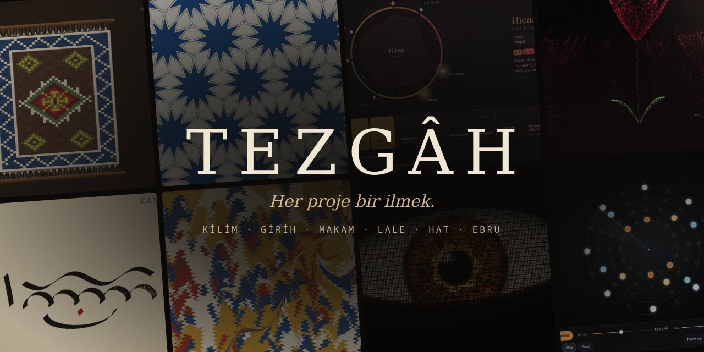

# Tezgâh

**Türk sanatlarını koda döken etkileşimli web deneyleri.**<br>
Kilim, girih, makam, hat, ebru… Canvas, WebGL ve Web Audio ile, bağımlılıksız.

[](https://py.execore.cloud/)
[](#sahne)
[](LICENSE)
[](#yapı)

</div>

---

Merhaba, ben **Ali Zafer**. 👋

> *Tek satır bir niyet, her proje bir izdir.*

Tezgâh, kendi deneylerimi dokuduğum yer. Her proje tek bir fikrin peşinden gidiyor: bir kilim nasıl dokunur, bir girih yıldızı hangi açıdan doğar, Hicaz'ı Hicaz yapan o koma farkı kulağa nasıl gelir, kamış kalemin ucu kâğıtta neden kalınlaşıp incelir? Cevabı bir tarayıcı sekmesinde, elle dokunulabilir hale getirmeye çalışıyorum.

🌐 [alizafer.tr](https://alizafer.tr) · 🐙 [@AliZafer0](https://github.com/AliZafer0) · 🧶 [Canlı galeri](https://py.execore.cloud/)

## Sahne

Her kart projenin canlı adresine gider; **Kaynak** bağlantısı projenin kendi README'sine.

<table>
<tr>
<td width="50%" valign="top">
<a href="https://py.execore.cloud/projects/kilim-loom/">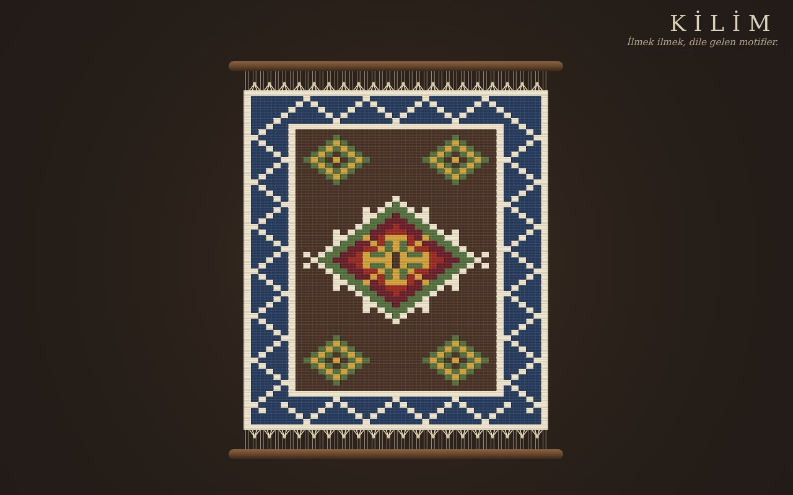</a>
<h3>🧶 Kilim — Dijital Tezgâh</h3>
Elibelinde, koçboynuzu, kurt izi… Simetrik motif damgası, kendiliğinden kurulan kilimler ve mekikle dokuma.<br>
<a href="https://py.execore.cloud/projects/kilim-loom/">Canlı</a> · <a href="projects/kilim-loom/">Kaynak</a>
</td>
<td width="50%" valign="top">
<a href="https://py.execore.cloud/projects/girih-geometry/">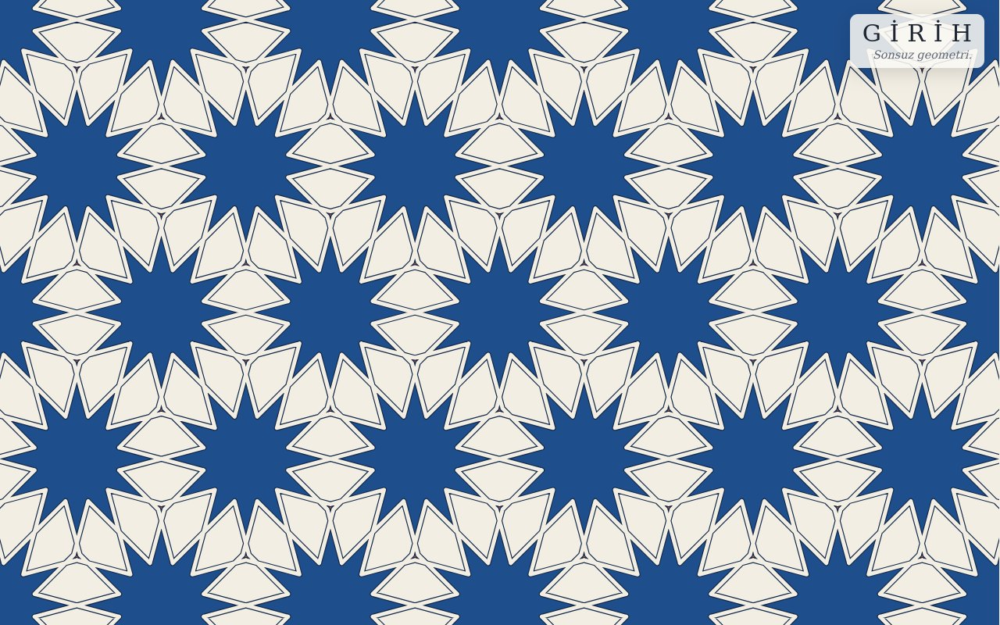</a>
<h3>✴️ Girih — Sonsuz Geometri</h3>
Selçuklu ve Osmanlı yıldız desenleri, Hankin'in "temas eden çokgenler" yöntemiyle. Açıyı sürükle, desen dönüşsün.<br>
<a href="https://py.execore.cloud/projects/girih-geometry/">Canlı</a> · <a href="projects/girih-geometry/">Kaynak</a>
</td>
</tr>
<tr>
<td width="50%" valign="top">
<a href="https://py.execore.cloud/projects/makam-keys/">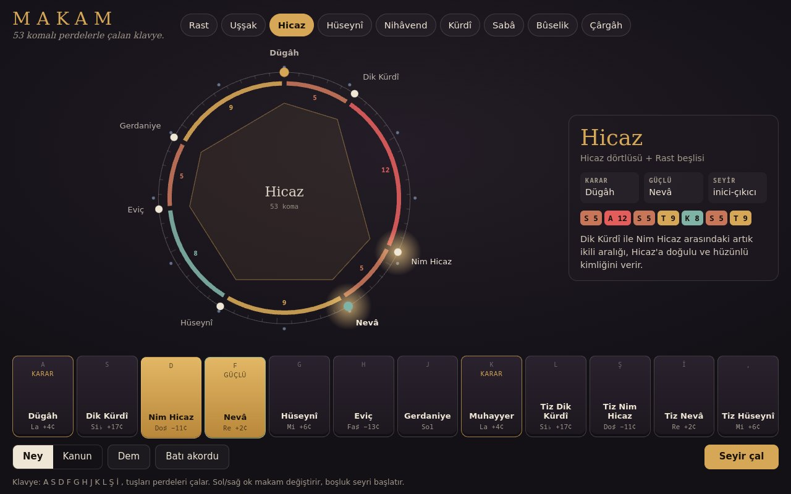</a>
<h3>🎶 Makam Klavyesi</h3>
53 komalı gerçek perdeler, ney ve kanun sesi, dem, kendiliğinden seyir. "Batı akordu" ile farkı duy.<br>
<a href="https://py.execore.cloud/projects/makam-keys/">Canlı</a> · <a href="projects/makam-keys/">Kaynak</a>
</td>
<td width="50%" valign="top">
<a href="https://py.execore.cloud/projects/lale-field/">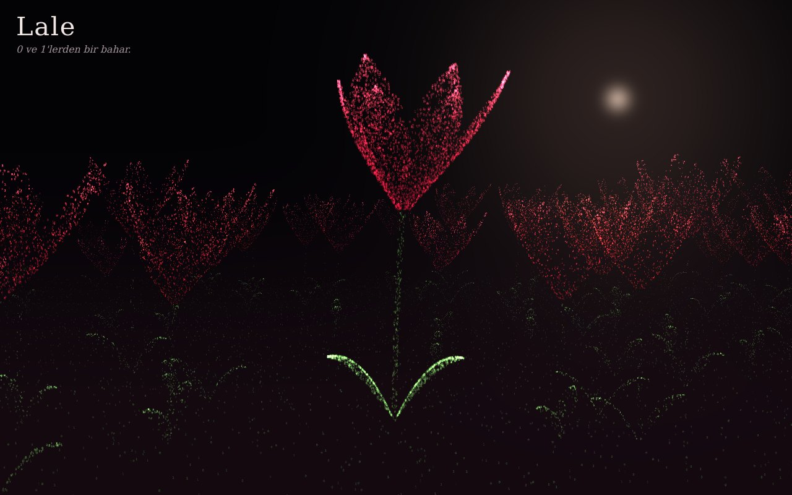</a>
<h3>🌷 Lale — 0 ve 1'lerden</h3>
Binlerce karakterden bir gece lale tarlası. Gezdir, rüzgâr essin; basılı tut, laleler açsın.<br>
<a href="https://py.execore.cloud/projects/lale-field/">Canlı</a> · <a href="projects/lale-field/">Kaynak</a>
</td>
</tr>
<tr>
<td width="50%" valign="top">
<a href="https://py.execore.cloud/projects/kamis-kalem/">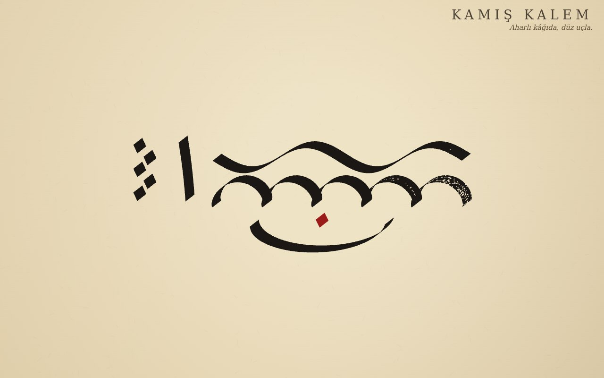</a>
<h3>🖋️ Kamış Kalem</h3>
Düz uçlu kalemle aharlı kâğıda yazı: kalın-ince geçişler açıdan doğar, kalem kurudukça iz lif lif ayrışır.<br>
<a href="https://py.execore.cloud/projects/kamis-kalem/">Canlı</a> · <a href="projects/kamis-kalem/">Kaynak</a>
</td>
<td width="50%" valign="top">
<a href="https://py.execore.cloud/projects/ebru-water/">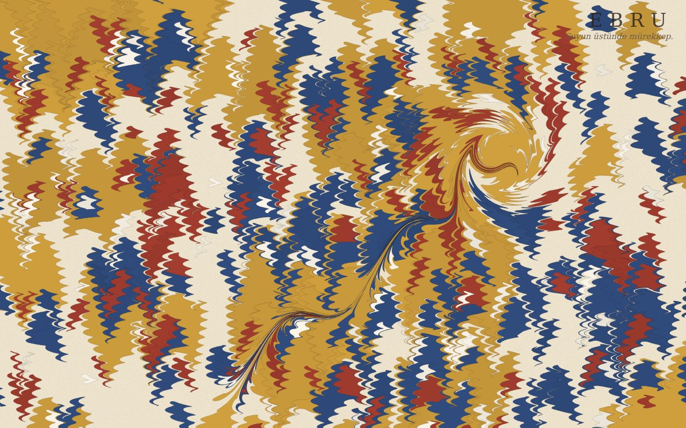</a>
<h3>🌊 Ebru — Suyun Üstünde</h3>
Damla, biz, tarak ve gelgit: ebrunun matematiğiyle, alanı koruyarak akan boya.<br>
<a href="https://py.execore.cloud/projects/ebru-water/">Canlı</a> · <a href="projects/ebru-water/">Kaynak</a>
</td>
</tr>
<tr>
<td width="50%" valign="top">
<a href="https://py.execore.cloud/projects/binary-bloom/">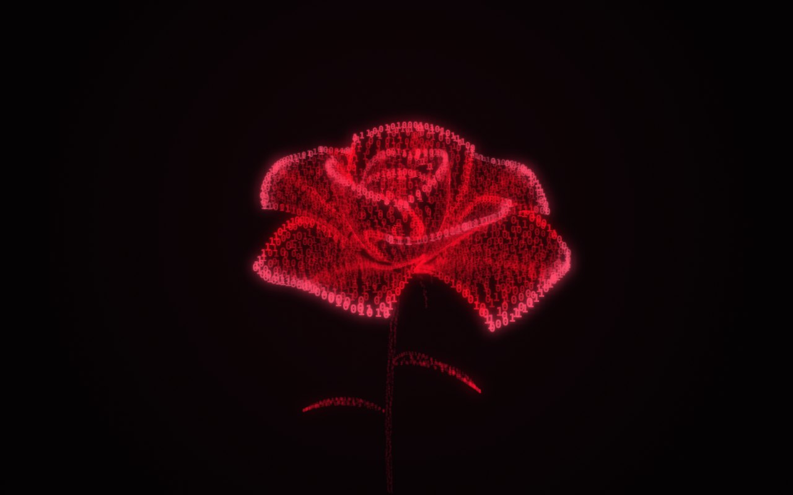</a>
<h3>🌹 Binary Bloom</h3>
0 ve 1'lerden filizlenen, üç boyutlu bir gül. Binary serisinin ilki.<br>
<a href="https://py.execore.cloud/projects/binary-bloom/">Canlı</a> · <a href="projects/binary-bloom/">Kaynak</a>
</td>
<td width="50%" valign="top">
<a href="https://py.execore.cloud/projects/iris-gaze/">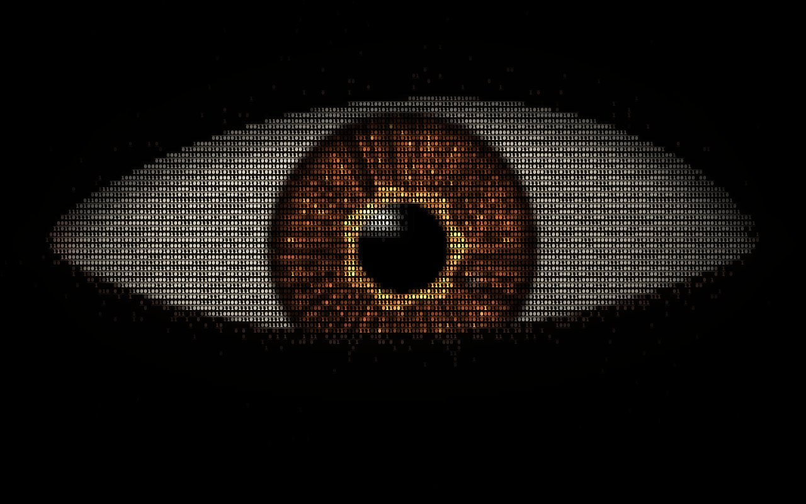</a>
<h3>👁️ Iris — Dijital Bakış</h3>
İmlecini izleyen, kırpan, kendi ritminde etrafa bakan bir göz.<br>
<a href="https://py.execore.cloud/projects/iris-gaze/">Canlı</a> · <a href="projects/iris-gaze/">Kaynak</a>
</td>
</tr>
<tr>
<td width="50%" valign="top">
<a href="https://py.execore.cloud/projects/mira-face/">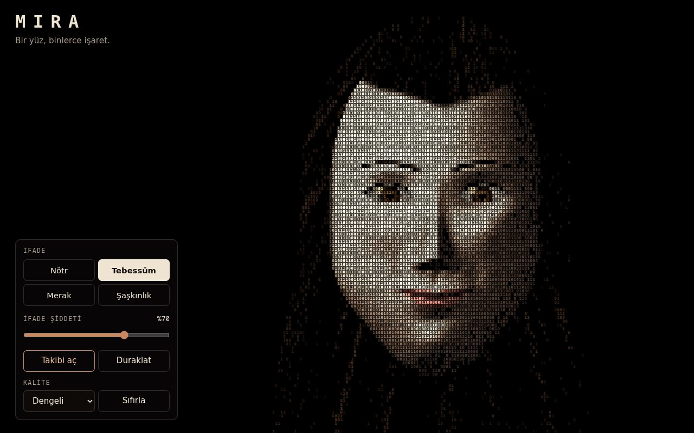</a>
<h3>🙂 Mira — Dijital Mimik</h3>
Bakışları ve ifadeleri birlikte hareket eden, karakterlerden bir portre.<br>
<a href="https://py.execore.cloud/projects/mira-face/">Canlı</a> · <a href="projects/mira-face/">Kaynak</a>
</td>
<td width="50%" valign="top">
<a href="https://py.execore.cloud/projects/orbit-sequencer/">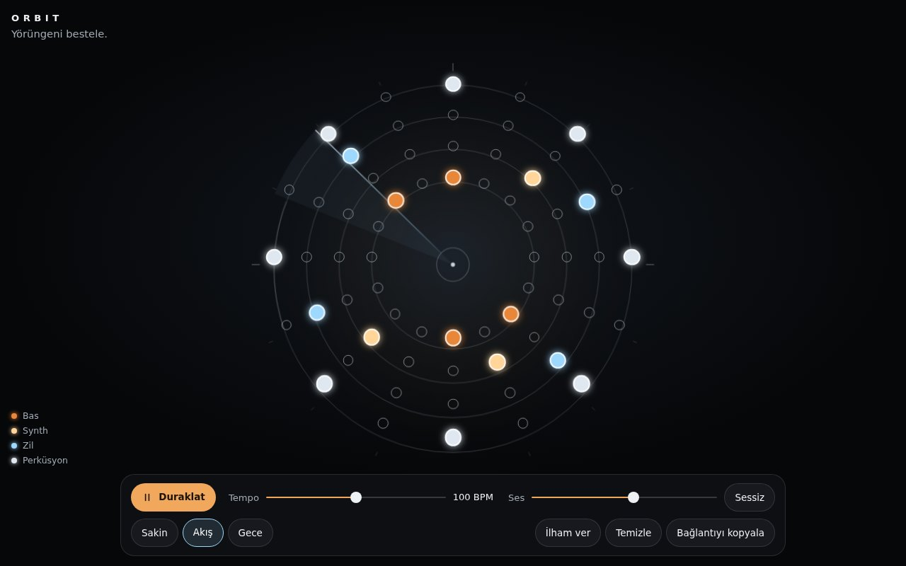</a>
<h3>🪐 Orbit — Yörünge Enstrümanı</h3>
Noktalardan ritim, yörüngelerden müzik. Besteni bir bağlantıyla paylaş.<br>
<a href="https://py.execore.cloud/projects/orbit-sequencer/">Canlı</a> · <a href="projects/orbit-sequencer/">Kaynak</a>
</td>
</tr>
<tr>
<td width="50%" valign="top">
<a href="https://py.execore.cloud/projects/impossible-room/">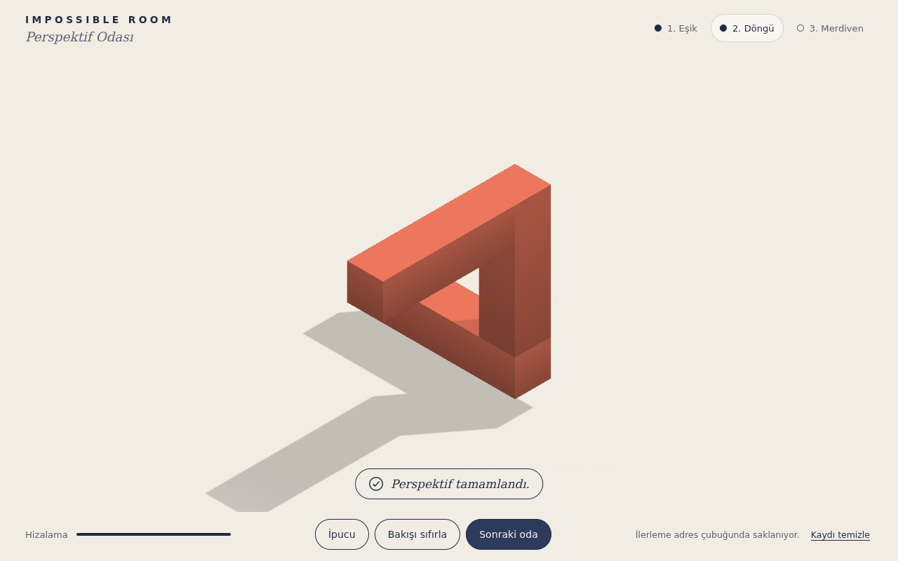</a>
<h3>🧩 Impossible Room</h3>
Dağınık mimari parçaları doğru bakış açısıyla birleştiren bir perspektif bulmacası.<br>
<a href="https://py.execore.cloud/projects/impossible-room/">Canlı</a> · <a href="projects/impossible-room/">Kaynak</a>
</td>
<td width="50%" valign="top">
<h3>🎭 Sırada</h3>
Karagöz Perdesi: arkadan kandille aydınlanan perde, eklemli deri tasvirler. Tezgâhta dokunuyor.
</td>
</tr>
</table>

## Atölye

Projelerin arkasındaki fikirler. Ayrıntılar her projenin kendi README'sinde.

| Proje | Teknik çekirdek |
| --- | --- |
| [Kilim](projects/kilim-loom/) | Bit eşlem motifler, 1/2/4 katlı simetri, tohumlu kilim üreteci, renk sınırında kilim yırtmacı, adreste RLE + base64url |
| [Girih](projects/girih-geometry/) | Periyodik döşemeler + Hankin ışınları; ışınların paralelleştiği "kör açı"da çevrel çembere kesme |
| [Makam Klavyesi](projects/makam-keys/) | Arel–Ezgi–Uzdilek 53 koma sistemi, dörtlü/beşli tabanlı makamlar, örneksiz Web Audio sentezi, seyir üreteci |
| [Lale](projects/lale-field/) | Tek çizim çağrısında ~130 bin nokta; açılma, rüzgâr ve esinti dalgaları vertex shader'da |
| [Kamış Kalem](projects/kamis-kalem/) | Süpürülen düz uç (kalınlık yön ve açıdan doğar), tek yolda birleştirilen dörtgenler, belirlenimli kuru kalem |
| [Ebru](projects/ebru-water/) | Alanı koruyan kapalı biçimli dönüşümler (Jaffer & Lu, 2012) |
| [Binary Bloom](projects/binary-bloom/) · [Iris](projects/iris-gaze/) · [Mira](projects/mira-face/) | Karakterden görüntü: derinlik maskesi, iki geçişli hücre çizimi, HDR + bloom |
| [Orbit](projects/orbit-sequencer/) | Ses saatine bağlı ileri zamanlayıcı, erişilebilir nota ızgarası |
| [Impossible Room](projects/impossible-room/) | Ortografik izdüşümde derinlik boyunca kaydırılan parçalar, histerezisli çözüm algılama |

Ortak ilkeler:

- **Bağımlılıksız projeler:** Her proje düz HTML, CSS ve JavaScript; doğrudan açılır.
- **Erişilebilirlik:** Klavyeyle kullanım, ekran okuyucu duyuruları ve `prefers-reduced-motion` desteği her projede var.
- **Paylaşılabilirlik:** Tarayıcı deposu yok; durum adreste taşınır, bağlantıyı açan aynı eseri görür.
- **Yalıtım:** Her proje galeride ayrı ve kilitli bir çerçevede (sandbox iframe) çalışır.

## Yapı

```
tezgah/
├─ apps/hub/          galeri: Vite + Three.js, projeleri kendiliğinden bulur
├─ projects/
│  ├─ _template/      yeni proje şablonu
│  └─ <proje>/        index.html · style.css · *.js · playground.json · README.md
├─ scripts/           geliştirme sunucusu, derleme, doğrulama, proje oluşturma
├─ tests/             birim testleri ve tarayıcı testi
├─ deploy/apache/     örnek statik yayın yapılandırması
└─ docs/              geliştirme rehberi ve görseller
```

```bash
git clone https://github.com/AliZafer0/tezgah.git
cd tezgah
npm install
npm run dev                              # http://127.0.0.1:4780/
npm run create:project -- yeni-fikir     # şablondan yeni proje
npm run build                            # dist/: her yerde çalışan statik çıktı
```

Node.js 22 veya üstü gerekir. Galeri, metadata, önizleme güvenliği ve yayın için: **[docs/gelistirme.md](docs/gelistirme.md)**.

## Emek

- Kod **[MIT](LICENSE)** lisanslıdır; dilediğin gibi kullan, değiştir, paylaş. Bir ilmek de senden gelirse ne mutlu.
- Hata, öneri ya da yeni bir fikir için [Issues](https://github.com/AliZafer0/tezgah/issues) açık.
- Ebru motoru, A. Jaffer ve S. Lu'nun *Mathematical Marbling* çalışmasına; girih desenleri E. H. Hankin'in yöntemine dayanır. Kaynakların tamamı projelerin README'lerinde.

<div align="center">
<br>
<sub>ilmek ilmek dokundu</sub>
</div>

<!--
   ┌───────────────────────────┐
   │  S  ·  A  ·  Y  ·  E      │
   │  Sahne Atölye Yapı Emek   │
   └───────────────────────────┘
-->
