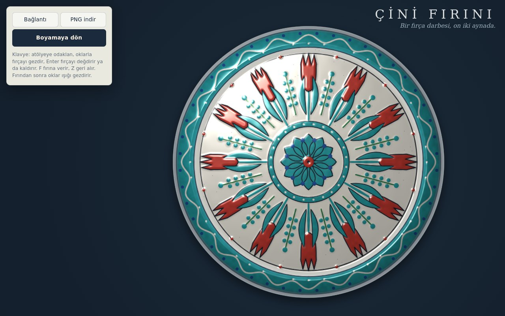

# Çini Fırını

**[Canlı aç](https://py.execore.cloud/projects/cini-firini/)** · [Galeride önizle](https://py.execore.cloud/#/onizleme/cini-firini) · [← Tezgâh](../../README.md)

> İznik çinisi boya: tek fırça darbesi kaleydoskop simetrisiyle çoğalır; fırına verince renkler canlanır, sır ışığı yakalayıp parlar.

## Ne yapar?

Tabağa ya da karoya fırça sür, kapalı bir biçim çizip boyayla doldur, benek bırak. Her iz seçili simetriyle (1–12 kat, istersen aynalı) bütün çiniye çoğalır. Boya önce pişmemiş sır gibi mat ve soluktur; **Fırına ver** deyince fırın 900 dereceye ısınır, soğuyunca kobalt, firuze ve mercan kırmızısı canlanır, yüzey camlaşır. Fırından sonra imleci ya da parmağını gezdirdikçe ışık sırın üstünde kayar. Karolar fırından sonra 3 × 3 duvara dizilebilir: köşe ve kenar motifleri komşu karolarla birleşir.

## Nasıl çalışır?

- **Simetri:** Fırça izleri birim uzayda saklanır. Çizim, her iz için n dönme (aynalıysa 2n) matrisinden geçirilir; her biri tek bir `setTransform` + `stroke` çağrısıdır.
- **Boya katmanı:** Opak boya ve yuvarlak uçlar sayesinde iz, sürülürken parça parça çizilir; geri almada katman baştan kurulur.
- **Fırınlama:** Aynı izler üç kez çizilir: pişmiş renkler, yükseklik haritası (mercan kırmızısı, gerçek İznik'teki *bolus* gibi kabarıktır) ve maske. Yükseklik haritası iki kez kutu bulanıklığından geçer; tabağın kendi biçimi (çukur, kavis, kenar) ve sırın hafif dalgalanması eklenir; farklarından normal hesaplanır.
- **Sır parlaması:** Nokta ışık ve sonsuzdaki gözle Blinn–Phong: üs 256 ile keskin parlama ve geniş bir hale, eğimli kenarda gökyüzü yansıması. Kuvvetler `pow` yerine ardışık karelemeyle alınır. Gölgeleme yalnızca ışık hareket ettiğinde yeniden yapılır.
- **Örnek desen:** Tohumlu üreteç yalnızca ilk dilimi (0 … π/n) kurar: rozet göbek, lale ve saz yaprağı, sümbül ya da karanfil, kenarda dalga kuşağı. Kosinüs dalgası dilim sınırında yatay bittiği için aynada kırılmadan sürer.
- **Adres:** Biçim, kat, ayna ve fırın durumu + izler (12 bitlik ilk nokta, ardından zigzag varint farklar) base64url olarak adreste taşınır.

## Kontroller

- **Biçim:** tabak ya da karo
- **Araç:** fırça, dolgu (kapalı biçim), benek
- **Boya:** kobalt, firuze, mercan, zümrüt, patlıcan moru, tahrir siyahı, beyaz astar (silgi)
- **Kalınlık / Kat / Ayna**
- **Klavye:** atölyeye odaklan, oklarla fırçayı gezdir (Shift ile hızlı), Enter fırçayı değdirir ya da kaldırır. F fırına verir, Z geri alır. Fırından sonra oklar ışığı gezdirir.
- **PNG indir:** fırınlanmışsa o anki ışıkla, 1200 piksel, şeffaf zeminde

## Arka plan

İznik çinisinin altın çağı 16. yüzyıldır: beyaz astar üstüne kobalt, firuze ve başka hiçbir atölyenin tutturamadığı kabarık mercan kırmızısı; desenleri siyah *tahrir* çizgisi çevreler. Lale, karanfil, sümbül ve saz yaprağı bu dönemin "dört çiçek" üslubundandır.

## Dosyalar

| Dosya | İçerik |
| --- | --- |
| `cini.js` | boyalar, simetri dönüşümleri, iz sadeleştirme, adres kodlaması, örnek desen üreteci |
| `app.js` | boya katmanı, fırın animasyonu, yükseklik ve normal hesabı, sır gölgelemesi, etkileşim |

---

Bağımlılık yok: dosyaları bir statik sunucuda aç ya da depo kökünde `npm run dev` çalıştır. Tezgâh'ın bir ilmeği.
