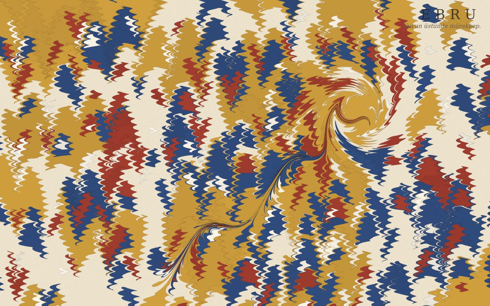

# Ebru — Suyun Üstünde

**[Canlı aç](https://py.execore.cloud/projects/ebru-water/)** · [Galeride önizle](https://py.execore.cloud/#/onizleme/ebru-water) · [← Tezgâh](../../README.md)

> Suyun üstünde boya: damla, serpme, biz, tarak ve gelgitle ebrunun matematiğiyle çalışan dijital bir tekne.

## Ne yapar?

Teknedeki suya boya damlat, bizle çek, tarakla tara. Battal, gelgit, taraklı ve lale desenleri hazır başlangıçlardır. "Kâğıda bas" yüzeyi yüksek çözünürlüklü PNG olarak indirir; isteğe bağlı su sesi de var.

## Nasıl çalışır?

- Her boya lekesi kapalı bir çokgendir. İşlemler, yüzeydeki boyayı alanı koruyarak iten kapalı biçimli dönüşümlerdir.
- Damla: `P' = C + (P − C) · √(1 + r² / |P − C|²)`. Biz/tarak çizgisi: `P' = P + z · u^d · M`. Girdap ise noktaları merkez çevresinde uzaklığa bağlı bir açıyla döndürür.
- Nokta bütçesi aşılınca kenar çözünürlüğü kademeli düşer. Çizim yalnızca bir şey değiştiğinde yapılır.

## Kontroller

- **Araçlar**: damla, serpme, biz, tarak, gelgit, girdap
- **Klavye**: tekneye odaklan, oklarla imleci taşı, Enter ile uygula; Biz için Shift + oklar

## Arka plan

Ebru, su üstüne serpilen boyaların kâğıda alınmasıyla yapılan geleneksel bir kâğıt süsleme sanatıdır.

## Dosyalar

| Dosya | İçerik |
| --- | --- |
| `marbling.js` | ebru dönüşümleri |
| `app.js` | araçlar, desenler, geri alma, ses, dışa aktarma |

## Kaynaklar

- A. Jaffer, S. Lu, *Mathematical Marbling* (IEEE CG&A, 2012)

---

Bağımlılık yok: dosyaları bir statik sunucuda aç ya da depo kökünde `npm run dev` çalıştır. Tezgâh'ın bir ilmeği.
