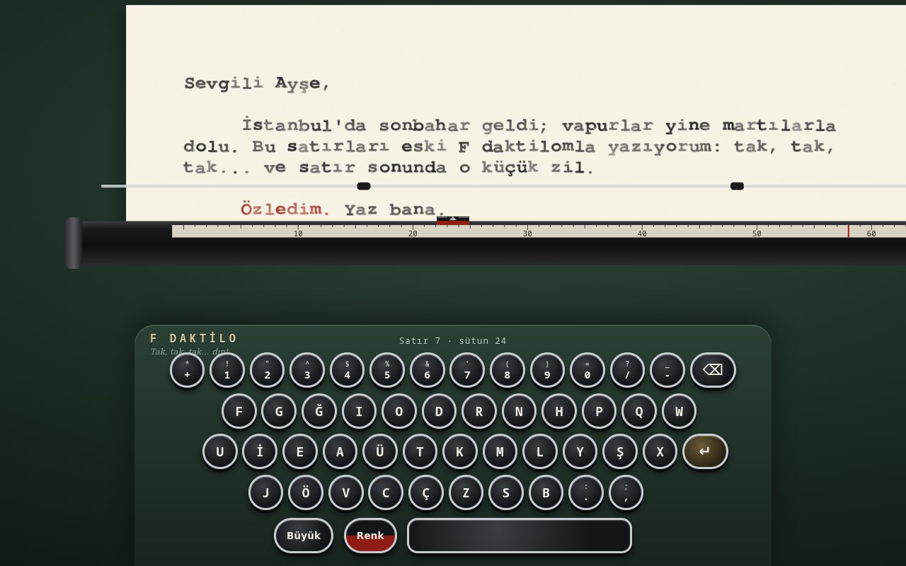

# F Daktilo

**[Canlı aç](https://py.execore.cloud/projects/f-daktilo/)** · [Galeride önizle](https://py.execore.cloud/#/onizleme/f-daktilo) · [← Tezgâh](../../README.md)

> Türkçe F klavyeli daktilo: tuş vuruşu, şerit mürekkebi, satır sonu zili. Yazdığın sayfayı çekip resim olarak indir ya da bağlantıyla paylaş.

## Ne yapar?

Klavyenle ya da ekrandaki yuvarlak tuşlarla yaz: her harf kâğıda şerit mürekkebiyle basılır, şaryo bir diş sola kayar. Sağ kenara altı harf kala zil çalar, kenara gelince tuşlar kilitlenir; Enter şaryoyu tıkırdatarak başa döndürür. Geri tuşu silmez, şaryoyu bir harf geri alır; üstüne basarsan harfler üst üste biner. Şerit siyah ya da kırmızıya alınır, mürekkep yazdıkça azalır. Sayfa dolunca ya da istediğinde **Kâğıdı çek**: sayfa çıkar, PNG olarak iner, yerine boş kâğıt takılır.

## Nasıl çalışır?

- **Kâğıt ayrı bir tuvalde:** Sayfa 64 sütun, 40 satır. Her vuruş harfi bir kez kâğıt tuvaline basar; ekranda baskı noktası sabittir, kâğıt (şaryo) onun altında kayar.
- **Mürekkep dokusu:** Harf önce küçük bir tuvale çizilir, sonra rastgele mürekkep boşlukları ve eğik bir vuruş farkı oyulur, kâğıda çarpma kipiyle basılır. Üst üste basılan harf koyulaşır. Her harfin kendine özgü, hep aynı kusuru var (biraz yukarıda, aşağıda ya da yatık); bazı harfler hep biraz soluk basar.
- **Şerit:** Her harf mürekkebi azaltır; *Şeridi değiştir* tazeler. Renk değişimi sayfanın kaydına işlenir.
- **Ses:** Hiç kayıt yok. Vuruş, alçak bir gövde tonu, bant geçiren bir tıkırtı ve ince bir metal çınlaması; satır başı, hızla geri sayan dişli tıklarıyla kayış sesi; zil üç uyumsuz kısmi ton.
- **F düzeni:** Ekrandaki tuşlar Türkçe F düzeninde. *Q klavyede F düzeni* açıkken fiziksel tuşun yeri (`event.code`) F'deki karşılığına çevrilir: Q klavyenin Q tuşu f, W tuşu g basar. Büyük harfler Türkçe kurala göre (i → İ, ı → I).
- **Adres:** Sayfanın bütün vuruşları (harfler, satır başları, geri almalar, renk ve aralık değişimleri) UTF-8 ve base64url ile adreste taşınır. Açan kişi aynı sayfayı, aynı mürekkep dokusuyla görür (doku, vuruş sırasından tohumlanır).

## Kontroller

- **Yaz:** Klavye ya da ekrandaki tuşlar. **Enter** satır başı, **Geri** bir harf geri, **Sekme** beşer sütun.
- **Büyük:** Bir kez basınca tek harf, iki kez basınca kilit. **Renk:** Şerit rengini değiştirir.
- **Satır aralığı** 1, 1,5 ya da 2. **Ses** açılıp kapatılabilir.
- **Kâğıdı çek**, **Metni kopyala** (üst üste basılmış harflerin sonuncusuyla düz metin), **Bağlantı**.

## Dosyalar

| Dosya | İçerik |
| --- | --- |
| `klavye.js` | Türkçe F düzeni, Q konumundan F'ye eşleme |
| `ses.js` | vuruş, boşluk, zil, şaryo dönüşü ve kâğıt çekme sesleri |
| `app.js` | kâğıt, mürekkep dokusu, şaryo, merdane ve cetvel çizimi, tuşlar, adres |

---

Bağımlılık yok: dosyaları bir statik sunucuda aç ya da depo kökünde `npm run dev` çalıştır. Tezgâh'ın bir ilmeği.
