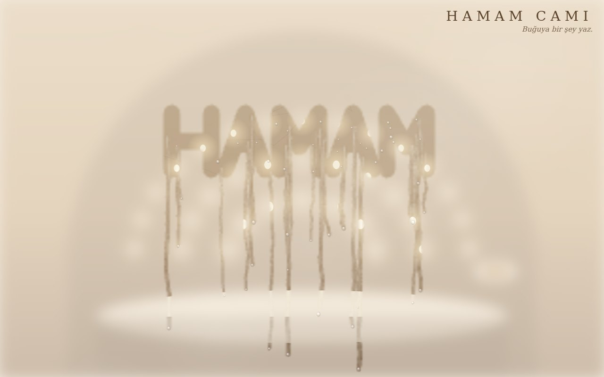

# Hamam Camı

**[Canlı aç](https://py.execore.cloud/projects/hamam-cami/)** · [Galeride önizle](https://py.execore.cloud/#/onizleme/hamam-cami) · [← Tezgâh](../../README.md)

> Buğulu hamam camına parmakla yaz: buğu yavaşça geri gelir, damlalar iz bırakarak süzülür; arkada kubbenin fil gözlerinden süzülen ışık.

## Ne yapar?

Camın arkasında bir hamam: mermer duvar, kubbedeki fil gözlerinden süzülen ışık, göbek taşı ve kurna. Önünde buğulanmış cam. Parmağınla ya da fareyle yazdığın yerden arkası keskin görünür. Silinen suyun bir kısmı çizginin kenarında damla olur; damlalar biraz bekler, ağırlaşınca süzülür, yol boyunca camı temizleyip ince bir iz bırakır. Buğu yavaş yavaş geri gelir: yazı solar, izler hayalet gibi kalır. *Buhar* ayarı bu hızı belirler, 0'da yazı hiç kaybolmaz.

## Nasıl çalışır?

- **İki görüntü, bir maske:** Sahne bir kez keskin, bir kez bulanık çizilir. Ekranda bulanık sahne ve süt beyazı sis var; silme maskesinin olduğu yerde keskin sahne gösterilir.
- **Düşük çözünürlüklü maske:** Maske ekranın dörtte biri çözünürlükte tutulur. Büyütülürken kenarlar kendiliğinden yumuşar, her karede bulanıklık filtresi gerekmez (telefonda akıcılık için).
- **Buğunun geri gelişi:** Maske her karede çok az silinir. 8 bitlik saydamlıkta küçük adımlar yuvarlanıp kaybolmasın diye adımlar birikip en az %2'lik dilimlerle uygulanır. Buhar 5'te yazı yaklaşık 15 saniyede solar.
- **Damla fiziği:** Çizginin kenarında doğan damlanın bir kütlesi var; önce yapışık bekler, sonra hızlanarak iner, ara ara takılır, giderek incelir. Bazı damlalar hiç düşmeden buharlaşır. Damla yolu maskeyi temizler ve ayrı bir katmana ince bir su izi bırakır.
- **Adres:** Buhar, parmak kalınlığı ve sahne adreste taşınır (`#5.5.k`).

## Kontroller

- **Dokun ve sürükle:** Cama yaz.
- **Hepsini sil**, **Buğulandır**, **Resim** (PNG).
- **Sahne:** Kurna başı (sıcak ışık) ya da Soğukluk (serin ışık). **Buhar** (0–9), **Parmak** (1–9).
- **Klavye:** Cama odaklanınca oklar parmağı gezdirir (Shift ile hızlı), Boşluk basılıyken siler.

## Dosyalar

| Dosya | İçerik |
| --- | --- |
| `app.js` | sahne, buğu maskesi, damla fiziği, çizim, kontroller |

---

Bağımlılık yok: dosyaları bir statik sunucuda aç ya da depo kökünde `npm run dev` çalıştır. Tezgâh'ın bir ilmeği.
