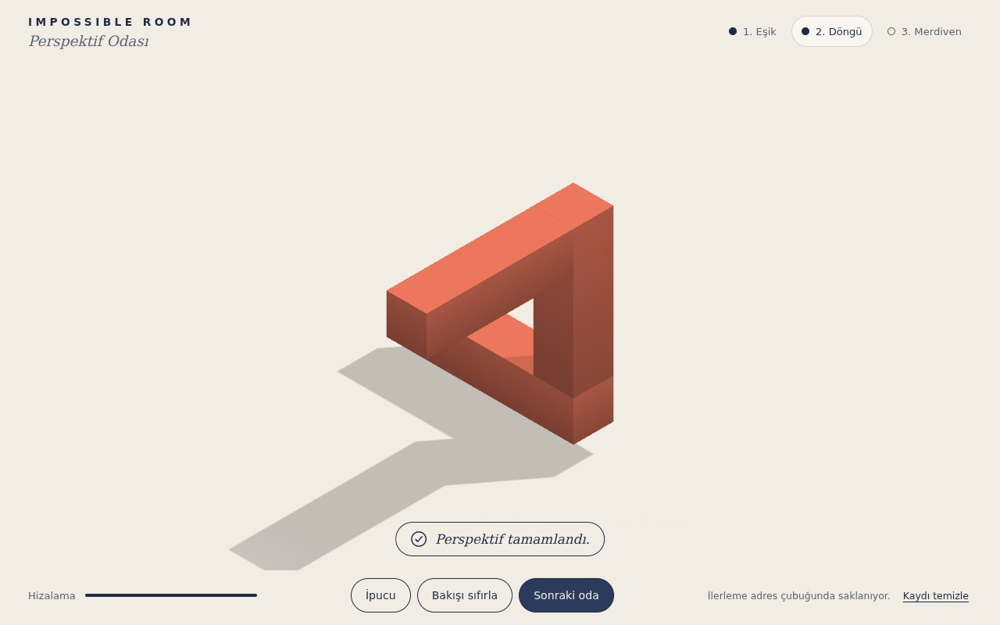

# Impossible Room — Perspektif Odası

**[Canlı aç](https://py.execore.cloud/projects/impossible-room/)** · [Galeride önizle](https://py.execore.cloud/#/onizleme/impossible-room) · [← Tezgâh](../../README.md)

> Dağınık mimari parçaları doğru bakış açısıyla birleştiren üç boyutlu bir perspektif bulmacası.

## Ne yapar?

Odadaki parçalar havada dağınık durur; sürükleyerek bakış açını değiştir. Doğru açıyı bulduğunda parçalar tek bir tutarlı yapı gibi birleşir. Birden fazla oda, ipucu ve ilerleme kaydı var.

## Nasıl çalışır?

- Her oda önce tutarlı bir yapı olarak kurulur, sonra parçalar çözüm bakış yönü boyunca farklı derinliklere kaydırılır.
- Ortografik izdüşümde bu yönde kaydırma ekrandaki görüntüyü değiştirmez: parçalar yalnızca o yönden bakınca birleşir, başka açılardan aradaki gerçek boşluk görünür.
- Çözüm algılamada histerezis vardır: içeri girerken sıkı, çıkarken gevşek tolerans. Çizim saf WebGL2 ile, yumuşak gölge haritasıyla yapılır ve yalnızca gerektiğinde tekrarlanır.

## Kontroller

- **Sürükle**: bakış açısı
- **İpucu / Bakışı sıfırla / Sonraki oda**

## Dosyalar

| Dosya | İçerik |
| --- | --- |
| `levels.js` | odalar ve parçaların kaydırılması |
| `renderer.js` | WebGL2 çizici, gölge |
| `script.js` | bulmaca akışı, çözüm algılama |

---

Bağımlılık yok: dosyaları bir statik sunucuda aç ya da depo kökünde `npm run dev` çalıştır. Tezgâh'ın bir ilmeği.
