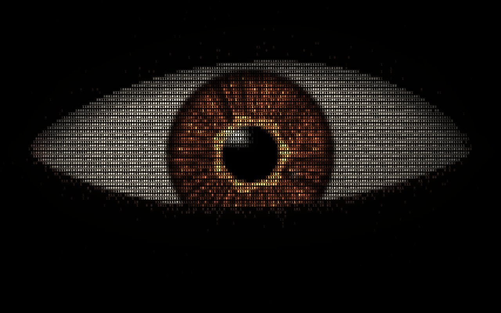

# Iris — Dijital Bakış

**[Canlı aç](https://py.execore.cloud/projects/iris-gaze/)** · [Galeride önizle](https://py.execore.cloud/#/onizleme/iris-gaze) · [← Tezgâh](../../README.md)

> Binlerce 0 ve 1'den oluşan, imleci takip eden ya da kendi ritminde etrafa bakan kahverengi bir göz.

## Ne yapar?

Ekranı dolduran bir göz imlecini izler, kırpar, takip kilitlenince kendi yoluna bakar. Binary serisinin ikincisi.

## Nasıl çalışır?

- İki geçişli WebGL2 çizici. Birinci geçişte her karakter hücresi için bir piksel hesaplanır: kapaklar, göz küresi, bakış dönüşü, iris dokusu, kornea yansımaları tamamen prosedüreldir.
- İkinci geçişte her hücreye, o hücrenin rengi ve parlaklığıyla bir 0 ya da 1 çizilir; karanlık hücreler seyrekleşir.
- Bakış, anatomik açı sınırlarına eşlenir; göz kırpma ve mikro hareketler kendi ritmindedir.

## Kontroller

- **İmleç**: bakışı yönlendirir
- **Takibi kilitle**: göz kendi yoluna bakar

## Dosyalar

| Dosya | İçerik |
| --- | --- |
| `eye-renderer.js` | iki geçişli çizici |
| `script.js` | bakış davranışı, kırpma, kontroller |

---

Bağımlılık yok: dosyaları bir statik sunucuda aç ya da depo kökünde `npm run dev` çalıştır. Tezgâh'ın bir ilmeği.
