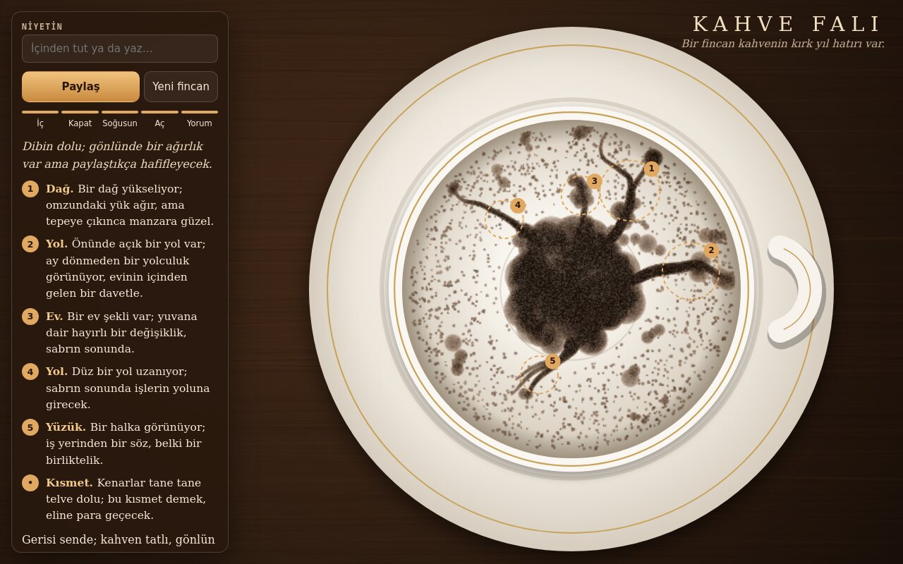

# Kahve Falı

**[Canlı aç](https://py.execore.cloud/projects/kahve-fali/)** · [Galeride önizle](https://py.execore.cloud/#/onizleme/kahve-fali) · [← Tezgâh](../../README.md)

> Kahveni iç, fincanı kapat, telve kurusun; akıp donan telvedeki şekiller bulunur ve onlardan eğlencelik bir fal yazılır.

## Ne yapar?

Masada köpüklü bir Türk kahvesi var. Niyetini tut, kahveni iç: yüzey dibe doğru çekilir, telve dipte kalır. Fincanı tabağa kapatınca ters döner ve soğur. Açtığında telve duvarlara akmış, kıvrılmış, topaklanmış olur. **Falıma bak** deyince fincandaki belirgin şekiller numaralanır: yol, yılan, kuş, balık, dağ, yüzük, ev, ağaç. Her birinin fincandaki yerine göre (kulba yakın mı, kenarda mı, dipte mi) bir yorum yazılır. Adres fincanın tohumunu taşır, paylaşılan bağlantı aynı fincanı açar.

## Nasıl çalışır?

- **Telve akışı:** Dipteki çamurdan birkaç dere çıkar ve kenara doğru akar. Yönleri bir gürültü alanının girdabıyla (curl) kıvrılır, atalet yönü yumuşatır. Dereler yol boyunca incelir, ara ara topak bırakır ve dallanır. Ters çevirme sırasında duvara sıçrayan lekeler ve tane tane telve ayrıca eklenir. Lekelerin kenarı ikinci bir gürültüyle düzensizleşir.
- **Şekil bulma:** 300×300'lük yoğunluk ızgarası 100×100'e indirilip eşiklenir. Dip bölgesi dışında kalan bağlı bileşenler çıkarılır. Her bileşen için kovaryansın öz değerlerinden uzama, ana eksen boyunca kütle profili, eksenden sapma (eğrilik), dışarıdan ulaşılamayan boşluk (delik) ve kutu doluluğu ölçülür.
- **Sınıflama:** Delikli olan yüzük, çok uzun olan yol (eğriyse yılan), iki ucu dolu ortası ince olan kuş, bir ucu ağır olan balık, iri ve toplu olan dağ, kutusunu dolduran ev, dağınık olan ağaç olur. Çok sayıda minik tane "kısmet" sayılır.
- **Yorum:** Şeklin açısı kulba göre "evinden / bir dosttan / uzaklardan", kenara uzaklığı "çok yakında / birkaç hafta içinde / sabrın sonunda" olur. Dibin doluluğu girişi, niyet yazıldıysa iyi şekillerin oranı sonucu belirler.

## Kontroller

- **Kahveni iç → Fincanı kapat → Fincanı aç → Falıma bak**, sonra **Paylaş** (bağlantıyı kopyalar) ya da **Yeni fincan**.
- **Niyetin:** İsteğe bağlı; adrese yazılmaz, yalnız bu sayfada kalır.

## Dosyalar

| Dosya | İçerik |
| --- | --- |
| `app.js` | gürültü alanı, telve akışı, şekil bulma ve sınıflama, fal metni, fincan çizimi, akış |

---

Fal eğlence içindir. Bağımlılık yok: dosyaları bir statik sunucuda aç ya da depo kökünde `npm run dev` çalıştır. Tezgâh'ın bir ilmeği.
