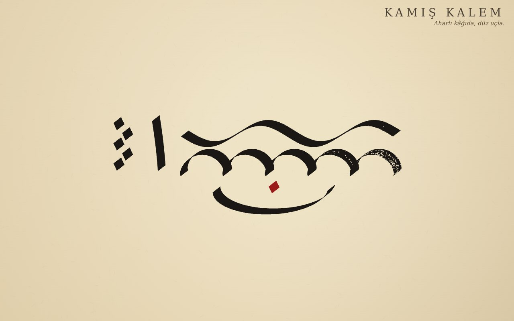

# Kamış Kalem

**[Canlı aç](https://py.execore.cloud/projects/kamis-kalem/)** · [Galeride önizle](https://py.execore.cloud/#/onizleme/kamis-kalem) · [← Tezgâh](../../README.md)

> Hattatın düz uçlu kamış kalemiyle aharlı kâğıda yazı: açıdan doğan kalın-ince geçişler, kuruyan kalem, nokta ölçüsü.

## Ne yapar?

Kâğıda yaz; çizgi, kalemin kesik ucunun açısına göre kendiliğinden kalınlaşır ve incelir. Kalem kurudukça iz lif lif ayrışır, hokkaya bandırınca dolar. Satır rehberi, kalem genişliğine göre satır aralığını ve hattatların ölçü birimi olan beş noktalık elif boyunu çizer. "Yazılışı izle" yazıyı yazıldığı sırayla yeniden akıtır.

## Nasıl çalışır?

- **Süpürülen uç:** Kalemin ucu bir doğru parçasıdır. İz, bu parçanın yol boyunca süpürülmesiyle oluşur. Hareket uca paralelken çizgi incelir, dikken kalınlaşır; ayrıca bir kalınlık hesabı yoktur.
- Bir vuruşun bütün dörtgenleri tek bir yolda toplanıp bir kerede boyanır. Hepsi aynı yönde döndürülür, böylece birleşim dikişi ve delik oluşmaz.
- Mürekkep, çekilen yol uzunluğuyla azalır. %62'nin altında uç 11 life ayrılır ve ortadaki yarık önce açılır. Doku belirlenimli gürültüyle üretilir; yeniden çizimde birebir aynı çıkar.
- Tek dokunuş, kalemin kendi izini, yani hattatın "nokta"sını (baklava) bırakır.

## Kontroller

- **Kalem / kat açısı**: uç genişliği ve açısı (önizlemede bir dairenin izi görünür)
- **Hokkaya bandır** ya da "Her harften sonra bandır"
- **Isınma örneği**: nokta merdiveni, elif, dalga, halkalar ve bir kâse
- **PNG indir**: rehbersiz, iki kat çözünürlük

## Arka plan

Aharlı kâğıt, yumurta akı ve nişastayla sıvanıp perdahlanmış, mürekkebi emmeyen kâğıttır. Hattatlar harf boylarını kalemin bıraktığı noktalarla ölçer.

## Dosyalar

| Dosya | İçerik |
| --- | --- |
| `pen.js` | uç, süpürme, kuru kalem, nokta |
| `app.js` | kâğıt, rehber, yazma, yeniden oynatma, ısınma, dışa aktarma |

---

Bağımlılık yok: dosyaları bir statik sunucuda aç ya da depo kökünde `npm run dev` çalıştır. Tezgâh'ın bir ilmeği.
