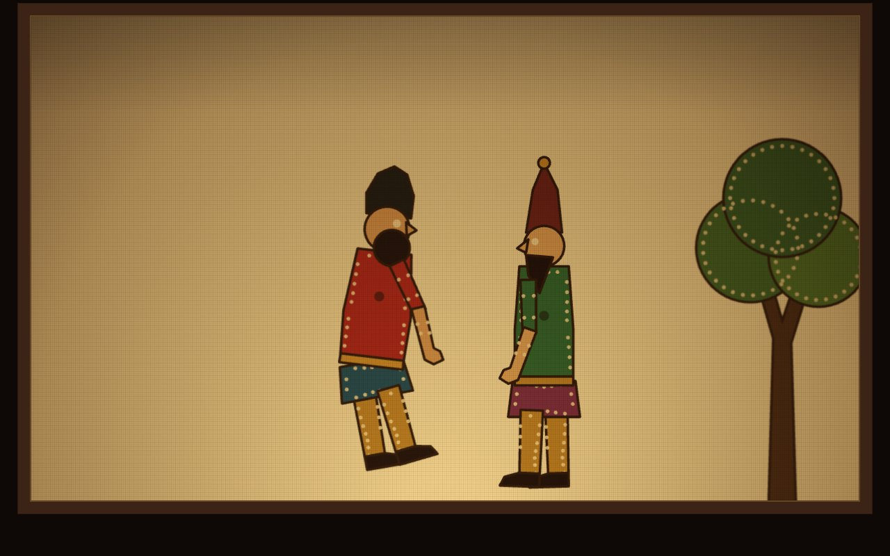

# Karagöz Perdesi

**[Canlı aç](https://py.execore.cloud/projects/karagoz-perde/)** · [Galeride önizle](https://py.execore.cloud/#/onizleme/karagoz-perde) · [← Tezgâh](../../README.md)

> Arkadan kandille aydınlanan perde ve deriden eklemli tasvirler: sürükle, salla, döndür, yürüt.

## Ne yapar?

Perde açılışta göstermelikle gelir; dokununca göstermelik kalkar, Karagöz ile Hacivat sahneye çıkar. Bir tasviri tutup sürükle: gövde harekete eğilir, kol ve bacaklar sarkaç gibi sallanır. Çift tıklayınca tasvir döner, "Yürüt" onu perdenin öbür yanına adım adım götürür. Tutulan tasvir perdeden biraz uzaklaşır: gölgesi büyür, bulanıklaşır, rengi solar. Kandil titrer, ışığı ayarlanabilir.

## Nasıl çalışır?

- **Eklemler sarkaçtır:** Her uzuv, bağlı olduğu eklemin ivmesine tepki veren sönümlü bir sarkaçtır: `α'' = −(g/L)·sin α − (aₓ·cos α − a_y·sin α)/L − k·(göreli açı − dinlenme) − c·α'`. Pivot ivmesi kare geçmişinden hesaplanır. Göreli açı eklem sınırlarında tutulur. Kararlılık için kare başına dört alt adım atılır.
- **Hiyerarşi:** Gövde → kol (üst + alt) ve gövde → kalça → iki bacak. Gövdenin eğimi hızdan gelir; çocuk parçalar bu eğime göre "aşağı"yı bulur.
- **Arkadan aydınlatılmış deri:** Her tasvir kendi küçük katmanına beyaz zemin üstüne çizilir. Sonra perdeye *multiply* ile basılır. Renkli, ışık geçiren deri perdeye tam böyle düşer; delik işçiliği beyaz kalarak ışığı geçirir.
- **Mesafe:** Perdeden uzaklaşan tasvirin katmanı büyütülür, `blur` ile bulanıklaştırılır ve saydamlaştırılır.
- **Döndürme:** Tasvir yatayda aynalanır. Açılar, hızlar, dinlenme açıları ve sınırlar birlikte çevrilir; sallanma kesintisiz sürer.

## Kontroller

- **Sürükle**: tasviri taşı (hızlıca ters yöne çekince döner)
- **Çift tıkla**: döndür
- **Yürüt / Döndür**: her tasvir için
- **Perdeden uzaklık / Kandil**: gölge ve ışık
- **Klavye**: perdeye odaklan; Enter göstermeliği kaldırır, 1–2 tasvir seçer, oklar taşır, boşluk döndürür, Enter yürütür

## Arka plan

Karagöz, deriden kesilip boyanan, eklemli tasvirlerin arkadan aydınlatılan bir perdeye yansıtıldığı geleneksel gölge oyunudur. Tasvirler çoğunlukla deve derisinden yapılır, ışık geçirsin diye inceltilir ve delik işçiliğiyle süslenir. Oyun, perdede duran bir göstermelikle başlar. Buradaki tasvirler bu projeye özgü sade çizimlerdir.

## Dosyalar

| Dosya | İçerik |
| --- | --- |
| `figures.js` | tasvirlerin parçaları, eklemleri, dekor ve göstermelik |
| `app.js` | sarkaç fiziği, perde ve ışık, katman basımı, etkileşim |

---

Bağımlılık yok: dosyaları bir statik sunucuda aç ya da depo kökünde `npm run dev` çalıştır. Tezgâh'ın bir ilmeği.
