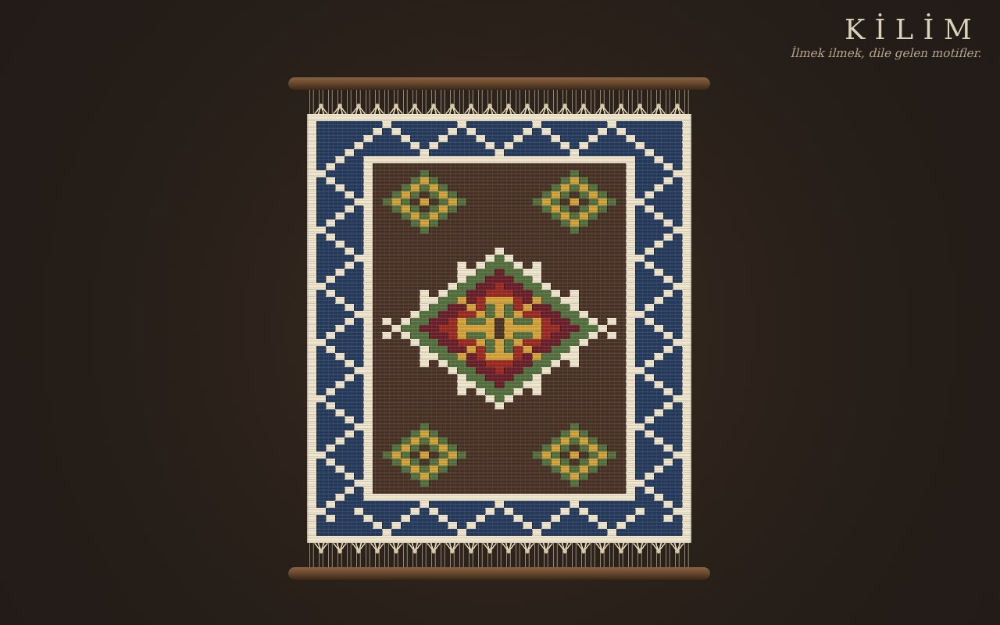

# Kilim — Dijital Tezgâh

**[Canlı aç](https://py.execore.cloud/projects/kilim-loom/)** · [Galeride önizle](https://py.execore.cloud/#/onizleme/kilim-loom) · [← Tezgâh](../../README.md)

> Anadolu kilim motifleriyle ilmek ilmek dokunan, simetrik ve paylaşılabilir bir dijital tezgâh.

## Ne yapar?

Tezgâha motif damgala, tek tek ilmek at ya da bir renk alanını baştan doku. Simetri açıksa her dokunuş aynasında da tekrarlanır. "Yeni kilim", bordürü, madalyonları ve köşe motifleriyle bütün bir kilimi kendiliğinden kurar ve mekik sıra sıra dokur. Kilimin tamamı adreste saklanır; bağlantıyı paylaşan herkes aynı kilimi görür.

## Nasıl çalışır?

- Kilim 41 × 61 ilmeklik bir ızgaradır; her hücre 8 kök boya renginden birini taşır.
- Motifler küçük bit eşlemleridir (`X` ana renk, `o` eş renk). Damga, seçili simetriye göre 1, 2 ya da 4 kez basılır.
- Üreteç tohumlu rastgelelikle çalışır: dış şerit → su yolu ya da baklava bordürü → eksen boyunca 1–3 çengelli göl → boş zemine sığan köşe motifleri. Bir motif, madalyona ya da başka bir motife çarpıyorsa yerleştirilmez.
- Gerçek kilimdeki *yırtmaç*: yan yana iki farklı renk arasında ince bir boşluk çizilir. Atkı dokusu tek hücrelik bir karo deseniyle bindirilir.
- Adres kodlaması: satır uzunluk kodlaması (renk 3 bit + tekrar 5 bit) ve base64url.

## Kontroller

- **Motif / İlmek / Zemin**: damga, tek ilmek (sürükleyerek), renk alanını doldurma
- **Simetri**: yok, ikili (dikey ayna), dörtlü
- **Klavye**: tezgâha odaklan, oklarla ilmek seç (Shift ile 5'er), Enter uygula, Z geri al
- **PNG indir**: kilim tek başına, saçaklarıyla, şeffaf zeminde

## Arka plan

Motiflerin anlamları halk arasındaki yaygın yorumlardır: elibelinde annelik ve bereket, koçboynuzu güç, göz ve muska nazardan korunma, pıtrak kötülüğe karşı, kurt izi sürüyü korumak, su yolu hayatın akışı.

## Dosyalar

| Dosya | İçerik |
| --- | --- |
| `motifs.js` | motifler, palet, simetri, damga, üreteç, adres kodlaması |
| `app.js` | tezgâh çizimi, dokuma animasyonu, etkileşim |

---

Bağımlılık yok: dosyaları bir statik sunucuda aç ya da depo kökünde `npm run dev` çalıştır. Tezgâh'ın bir ilmeği.
