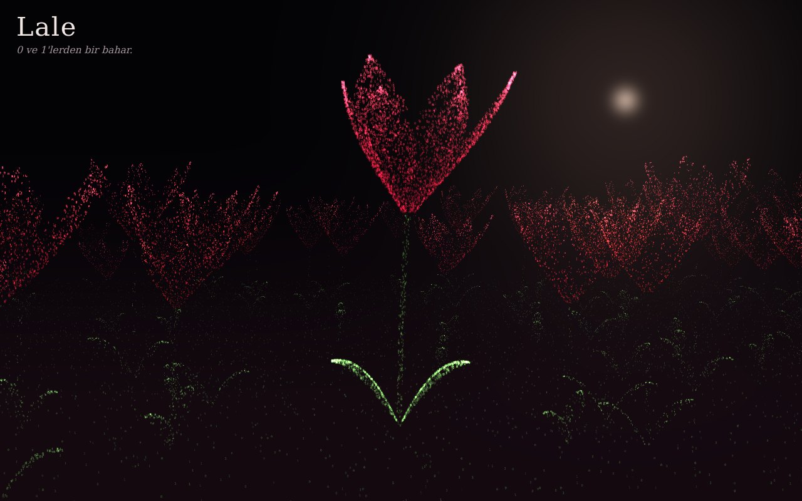

# Lale — 0 ve 1'lerden

**[Canlı aç](https://py.execore.cloud/projects/lale-field/)** · [Galeride önizle](https://py.execore.cloud/#/onizleme/lale-field) · [← Tezgâh](../../README.md)

> Binlerce 0 ve 1'den oluşan, rüzgârda salınan ve dokununca açan bir gece lale tarlası.

## Ne yapar?

Ortada hançer yapraklı bir İstanbul lalesi, çevresinde yüzlerce küçük lale. İmleci gezdirdikçe tarlada rüzgâr dalgaları yayılır; basılı tuttuğun yerdeki laleler açar, bırakınca yavaşça kapanır. Binary serisinin (Binary Bloom, Iris, Mira) dördüncüsü.

## Nasıl çalışır?

- Her karakter bir noktadır; tek bir `gl.POINTS` çağrısıyla ~50–130 bin nokta çizilir.
- CPU yalnızca parametreleri üretir (tür, lale, u, v, açı, glif). Taç yaprağın biçimi, açılma, rüzgâr ve sallanma vertex shader'da hesaplanır.
- Taç yaprak: kapalıyken badem biçimli tomurcuk, açıkken dışa kıvrılan ve uca doğru incelen bir yüzey; iki profil açılma oranıyla karıştırılır.
- Rüzgâr: sürekli bir esinti alanı + imleçten yayılan dört halka dalga. Sapın dibi sabit kalır, eğilme yükseklikle karesel artar.
- Glif atlasında keskin karakter ve yumuşak hale ayrı kanallardadır; toplamalı karışımla ışıltı oluşur. Yavaş cihazda piksel oranı kendiliğinden düşer.

## Kontroller

- **Gezdir**: rüzgâr
- **Basılı tut**: laleler açar
- **Klavye**: ←/→ kamerayı döndürür, boşluk bütün tarlayı açar ya da kapatır, W bir rüzgâr estirir

## Arka plan

Lale, Osmanlı sanatında ve 18. yüzyılın "Lale Devri"nde öne çıkan bir semboldür. İstanbul lalesi, iğne gibi uzun ve sivri yapraklarıyla bilinir.

## Dosyalar

| Dosya | İçerik |
| --- | --- |
| `tulip.js` | tarla yerleşimi, nokta parametreleri, renk aileleri |
| `renderer.js` | WebGL2 shader'ları, atlas, çizim |
| `app.js` | kamera, rüzgâr, açılma, kalite |

---

Bağımlılık yok: dosyaları bir statik sunucuda aç ya da depo kökünde `npm run dev` çalıştır. Tezgâh'ın bir ilmeği.
