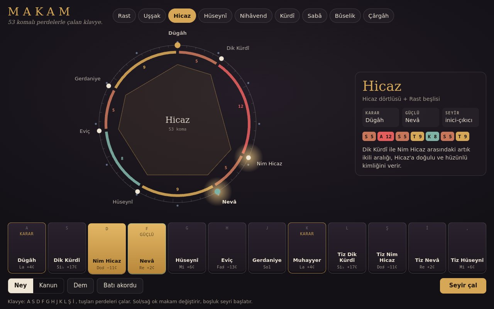

# Makam Klavyesi

**[Canlı aç](https://py.execore.cloud/projects/makam-keys/)** · [Galeride önizle](https://py.execore.cloud/#/onizleme/makam-keys) · [← Tezgâh](../../README.md)

> 53 komalı Türk müziği perdeleriyle çalan, makamın seyrini kendisi de gezinebilen bir klavye.

## Ne yapar?

Dokuz makam, her biri gerçek perde adlarıyla (Segâh, Nim Hicaz, Eviç…). Tuşlara bas, kaydırarak perdeden perdeye geç, ney ya da kanun sesiyle çal. "Dem" karar perdesinde sürekli bir taban sesi açar. "Seyir çal", makamın karakterine uygun kısa bir ezgiyi kendisi üretir. "Batı akordu" perdeleri 12 eşit sese yuvarlar; farkı hem halkada görür hem kulağınla duyarsın.

## Nasıl çalışır?

- **Arel–Ezgi–Uzdilek sistemi:** Oktav 53 komaya bölünür. Aralıklar: bakiye (4), küçük mücenneb (5), büyük mücenneb (8), tanini (9), artık ikili (12–13).
- Her makam dörtlü ve beşlilerden kurulur (ör. Hicaz = Hicaz dörtlüsü + Rast beşlisi). Perde frekansı: `f = 196 · 2^(k/53)` (Rast = Sol3).
- Halka: 53 komalık oktav. Mavi noktalar 12 eşit sesin yerleri; perdelerin bu noktalardan sapması gözle görülür.
- Ses: ney = sinüs + üst ses + bant geçiren nefes gürültüsü + geç başlayan vibrato; kanun = iki hafif ayrık testere dalgası, kararan süzgeç ve mızrap vuruşu. Hepsi Web Audio ile, örnek dosyası olmadan.
- Seyir üreteci: karardan (ya da güçlüden) başlar, güçlüde durak yapar, tize uzanır, süslemeli adımlarla inip kararda biter.

## Kontroller

- **Fare / dokunmatik**: bas, basılı tutup kaydır
- **Klavye**: A S D F G H J K L Ş İ , perdeleri çalar; ←/→ makam değiştirir; boşluk seyri başlatır

## Arka plan

Makam yalnızca bir dizi değildir; karar, güçlü ve seyir (ezginin dizide nasıl dolaştığı) makamı makam yapar. Buradaki seyirler öğretici birer taslaktır, gerçek bir icranın yerini tutmaz.

## Dosyalar

| Dosya | İçerik |
| --- | --- |
| `makams.js` | perdeler, aralıklar, makam tanımları, frekans |
| `audio.js` | ney, kanun, dem, yankı |
| `app.js` | halka, tuşlar, seyir üreteci |

---

Bağımlılık yok: dosyaları bir statik sunucuda aç ya da depo kökünde `npm run dev` çalıştır. Tezgâh'ın bir ilmeği.
