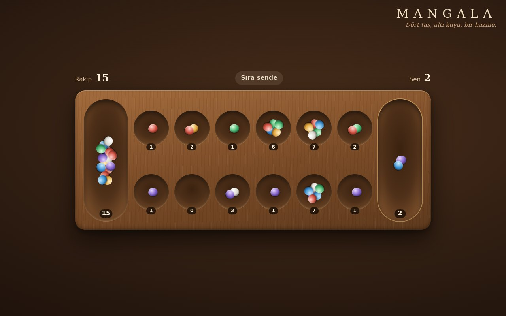

# Mangala

**[Canlı aç](https://py.execore.cloud/projects/mangala/)** · [Galeride önizle](https://py.execore.cloud/#/onizleme/mangala) · [← Tezgâh](../../README.md)

> Geleneksel taş toplama oyunu: oyulmuş ceviz tahta, cam taşlar, üç zorlukta yapay rakip, hamle önizlemesi ve kural rehberi.

## Ne yapar?

Altı kuyu, kırk sekiz taş, iki hazine. Bilgisayara karşı (kolay, orta, zor) ya da aynı cihazda iki kişi oynanır. Bir kuyunun üstüne gelince ya da klavyeyle odaklanınca taşların hangi kuyulara düşeceği, son taşın nereye geleceği ve hangi kuralı tetikleyeceği gösterilir: "hazineye düşer, bir daha oynarsın", "rakibin kuyusunu çift yapar, 6 taş senin". Taşlar renkleriyle kuyudan kuyuya gerçekten taşınır; hangi taşın nereye gittiği izlenebilir.

## Kurallar

1. Her kuyuda dört taşla başlanır.
2. Kendi tarafından bir kuyunun taşları alınır; ilk taş aynı kuyuya bırakılır, kalanlar saatin tersi yönünde birer birer dağıtılır. Kendi hazinene taş konur, rakibinkine konmaz.
3. Kuyuda tek taş varsa o taş bir sonraki kuyuya geçer.
4. **Hazine:** Son taş kendi hazinene düşerse bir daha oynarsın.
5. **Çift:** Son taş rakibin kuyusundaki sayıyı çift yaparsa o kuyu senin.
6. **Boş kuyu:** Son taş kendi boş kuyuna düşer ve karşısı doluysa iki kuyunun taşları senin.
7. **Bitiş:** Bir tarafın kuyuları boşalınca oyun biter; taşları biten, karşıda kalan taşları da alır.

Mangala bölgeden bölgeye küçük farklarla oynanır; burada en yaygın Türkiye kuralları kullanıldı.

## Nasıl çalışır?

- **Tahta:** 14 hücrelik bir dizi; hamle, taşları dizide saatin tersine dağıtan, rakibin hazinesini atlayan tek bir fonksiyon. Önizleme, aynı fonksiyonu tahtanın kopyasında çalıştırır.
- **Kolay rakip:** Çoğunlukla rastgele, arada bir hazineye düşen hamleyi görür.
- **Orta rakip:** Bir hamle ileri bakar; ek hamleleri zincirler, rakibin hemen alabileceğini düşer.
- **Zor rakip:** Alfa-beta budamalı negamax. Ek hamlede sıra değişmediği için işaret çevrilmez. Hazineye düşen ve taş alan hamleler önce denenir; arama 380 ms dolana kadar derinleşir (çoğu konumda 10–14 hamle). Rastgele oynayan rakibe karşı denemelerde 20 oyunun 20'sini kazandı.
- **Taş korunumu:** 2000 rastgele oyunda her hamleden sonra taş sayısının 48 kaldığı denetlendi.
- **Adres:** Oyun biçimi, zorluk, başlayan ve bütün hamleler adreste taşınır (`#bz0.36254`). Bağlantıyı açan oyunu aynı konumdan sürdürür; kurala uymayan bir hamleye rastlanırsa geçerli kısma kadar kurulur.

## Kontroller

- **Kuyuya dokun ya da tıkla:** Oyna. Üstüne gelmek ya da odaklanmak önizlemeyi gösterir.
- **Klavye:** Oklar sıradaki oyuncunun kuyuları arasında gezer, Enter oynar; 1–6 tuşları doğrudan o kuyuyu oynar.
- **Geri al:** Bilgisayara karşı kendi son hamlene kadar (rakibin cevaplarıyla birlikte) geri alır.
- **Rakip başlasın**, **ses** (taş tıkırtısı tarayıcıda üretilir), **kurallar** penceresi.

## Dosyalar

| Dosya | İçerik |
| --- | --- |
| `kurallar.js` | tahta, hamle, kurallar, bitiş; kolay, orta ve zor rakip |
| `app.js` | tahta çizimi, taş animasyonu, önizleme, ses, panel ve klavye |

---

Bağımlılık yok: dosyaları bir statik sunucuda aç ya da depo kökünde `npm run dev` çalıştır. Tezgâh'ın bir ilmeği.
