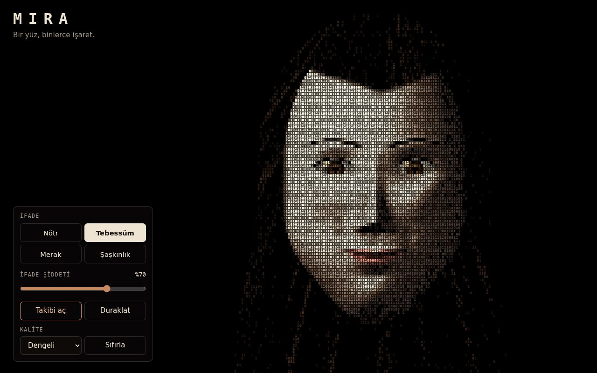

# Mira — Dijital Mimik

**[Canlı aç](https://py.execore.cloud/projects/mira-face/)** · [Galeride önizle](https://py.execore.cloud/#/onizleme/mira-face) · [← Tezgâh](../../README.md)

> Binlerce karakterden oluşan, bakışları ve ifadeleri birlikte hareket eden etkileşimli bir dijital portre.

## Ne yapar?

Mira imlecini izler; seçilen ifadeye göre kaşları, gözleri ve ağzı birlikte değişir. İfade şiddeti ayarlanabilir. Binary serisinin üçüncüsü.

## Nasıl çalışır?

- Yüz tek bir koordinat sisteminde parametrik bir yükseklik alanıdır. Başlangıçta bir kez hesaplanıp float dokuya yazılır (eğim, derinlik, ortam gölgesi).
- Ekran noktası poz → çene → ifade sırasıyla ters eşlenerek dinlenme yüzeyine bağlanır. Gözler kapak eğrileriyle kesilen kürelerdir; ağız açıklığı gerçek bir boşluktur.
- Karakter geçişi: parlak yerler sık ve kalın, gölgeler seyrek. Karakter başına çizim çağrısı ya da DOM düğümü yoktur.

## Kontroller

- **İmleç**: bakış
- **İfade** ve **İfade şiddeti**
- **Takibi kilitle / Duraklat / Sıfırla**

## Dosyalar

| Dosya | İçerik |
| --- | --- |
| `face-surface.js` | dinlenme yüzeyi |
| `face-renderer.js` | iki geçişli çizici |
| `app.js` | yüz durumu, ifade karışımı, bakış |

---

Bağımlılık yok: dosyaları bir statik sunucuda aç ya da depo kökünde `npm run dev` çalıştır. Tezgâh'ın bir ilmeği.
