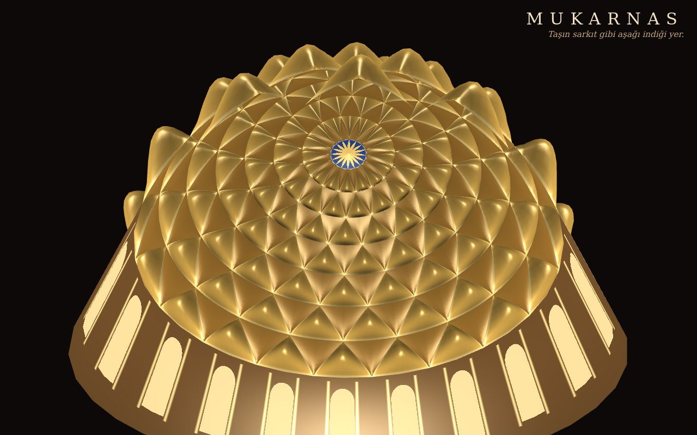

# Mukarnas

**[Canlı aç](https://py.execore.cloud/projects/mukarnas/)** · [Galeride önizle](https://py.execore.cloud/#/onizleme/mukarnas) · [← Tezgâh](../../README.md)

> Kat kat sarkan mukarnas kubbe üreteci: kat sayısı, hücre biçimi ve kaplamayla oyna, kandilin ışığında altından yukarı bak.

## Ne yapar?

Bir kubbeyi kat kat hücrelere böler: her katta 8 ile 32 arası niş, komşu katlar yarım hücre kaydırılmış. Açılışta tam ortadan yukarı bakarsın; kubbe yavaşça döner, ortada sallanan bir kandil hücrelerin kenarlarını parlatır. Sürükleyince eğilip kubbeyi yandan, kesit gibi görürsün. Hücre biçimi (sivri kemer, badem, petek), oyuk derinliği ve kaplama (alçı, altın, lacivert-turkuaz çini) değiştirilebilir; görüntü PNG olarak indirilir.

## Nasıl çalışır?

- **Kat ve kaydırma:** Kubbe profili, tabanda yarıçapı 1, tepede küçük bir göbekle biten bir çeyrek elips. Her kat iki halka arasında; bir nişin tabanı alt halkada, sivri ucu üst halkada durur. Bir üst kat yarım hücre kaydırıldığı için onun nişleri tam bu sivri uçların arasına oturur.
- **Dikişsiz yüzey:** İki komşu nişin arasında kalan ters üçgen bir "dolgu" yüzüyle kapanır. Dolgunun yan kenarları nişlerin kenar eğrisini izler, üst kenarı bir üst katın niş tabanıyla birebir çakışır; kubbede açık kalan yer olmaz.
- **Hücre biçimi:** Nişin yarı genişliği yüksekliğin bir fonksiyonu: kemerde sivri bir uçla, bademde yuvarlak, petekte önce dik sonra eğik kapanır.
- **Oyuk:** Niş yüzeyi kubbenin dışına ve biraz yukarı doğru, kenarlarda sıfır, ortada en derin olacak biçimde itilir. Normaller yama ızgarasında sonlu farklarla hesaplanıp içeri döndürülür.
- **Işık:** Kandil noktasal bir ışık; yansıma Blinn–Phong. Nişin başlık kısmı ek olarak gölgede bırakılır, kenarlar kaplamanın kenar rengiyle (altında parlak altın, çinide beyaz) çizilir. Tepe göbeğinde hücre sayısı kadar kollu bir şemse, kasnakta kemerli pencereler boyama aşamasında üretilir.
- **Kesit görünümü:** Ön yüzler ayıklandığı için kubbeye dışarıdan bakınca yakın duvar çizilmez; içi görünür.
- **Adres:** Kat, hücre, biçim, kaplama ve oyuk adreste taşınır (`#7.16.k.g.4`).

## Kontroller

- **Sürükle:** Etrafında dön ve eğ. **Tekerlek ya da iki parmak:** Yaklaş, uzaklaş.
- **Alttan bak:** Tam ortadan yukarı bakışa döner.
- **Klavye:** Kubbeye odaklanınca ← → döndürür, ↑ ↓ eğer, + − yaklaştırır.
- **Kat** (3–9), **katta hücre** (8, 12, 16, 24, 32), **hücre biçimi**, **oyuk**, **kaplama**, **yavaşça dön**, **resim indir**.

## Dosyalar

| Dosya | İçerik |
| --- | --- |
| `geometri.js` | kubbe profili, nişler, dolgular, şemse, kasnak; normaller |
| `app.js` | WebGL boyama, kandil ışığı, kamera, panel ve klavye |

---

Bağımlılık yok: dosyaları bir statik sunucuda aç ya da depo kökünde `npm run dev` çalıştır. Tezgâh'ın bir ilmeği.
