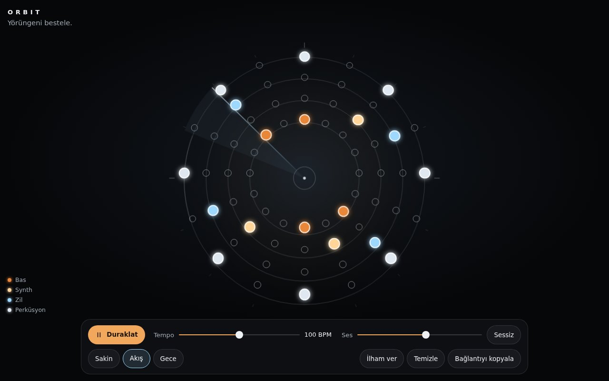

# Orbit — Yörünge Enstrümanı

**[Canlı aç](https://py.execore.cloud/projects/orbit-sequencer/)** · [Galeride önizle](https://py.execore.cloud/#/onizleme/orbit-sequencer) · [← Tezgâh](../../README.md)

> Noktalardan ritim, yörüngelerden müzik üreten etkileşimli bir enstrüman.

## Ne yapar?

İç içe dört halka: bas, synth, zil ve perküsyon. Noktalara dokun, kendi yörüngeni bestele. Tempo, ses ve ruh hâli (Sakin, Akış, Gece) değiştirilebilir. "İlham ver" yeni bir örüntü kurar, besteni bir bağlantıyla paylaşabilirsin.

## Nasıl çalışır?

- Notalar gerçek düğmelerdir (erişilebilir ızgara); halkalar, tarama çizgisi ve ışık tepkileri tek bir Canvas 2D üzerinde çizilir.
- Sesler Web Audio ile prosedürel üretilir ve ses saatine dayalı ileri zamanlayıcıyla çalınır; OfflineAudioContext ile test edilebilir.
- Beste ve tempo adreste kodlanır; açan kişi besteyi duraklatılmış olarak görür.

## Kontroller

- **Dokun / tıkla**: nota aç-kapat
- **Klavye**: oklarla halkalar ve adımlar arasında gezin

## Dosyalar

| Dosya | İçerik |
| --- | --- |
| `patterns.js` | örüntüler, perde haritası, kodlama |
| `audio.js` | sesler ve zamanlayıcı |
| `orbit-view.js` | yörünge görünümü |
| `script.js` | durum, paylaşım |

---

Bağımlılık yok: dosyaları bir statik sunucuda aç ya da depo kökünde `npm run dev` çalıştır. Tezgâh'ın bir ilmeği.
