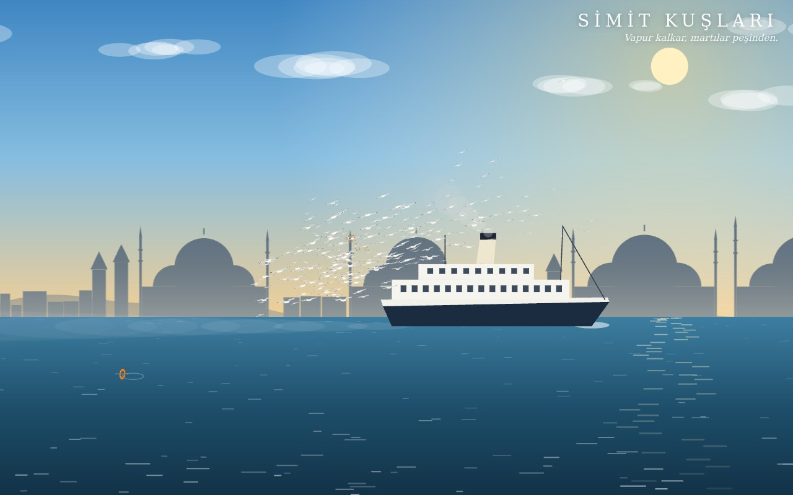

# Simit Kuşları

**[Canlı aç](https://py.execore.cloud/projects/simit-kuslari/)** · [Galeride önizle](https://py.execore.cloud/#/onizleme/simit-kuslari) · [← Tezgâh](../../README.md)

> Vapurun peşindeki martı sürüsü: dokunduğun yere simit at, sürü dalgalanarak üşüşsün.

## Ne yapar?

Vapur boğazda ilerler, şehir arkada akar, martılar kıç tarafının üstünde gevşek bir sekiz çizerek bekler. Göğe ya da denize dokununca vapurun kıçından o noktaya bir simit atılır. Simit havadayken de yakalanabilir, suya düşünce de; yakınındaki martılar sürüden kopup üşüşür, birer ısırık alıp çekilir. Altı ısırıkta simit biter. Sabah, ikindi ya da akşam; lodos ya da poyraz.

## Nasıl çalışır?

- **Sürü kuralları:** Her martı komşularından uzaklaşır (ayrılma), onlarla aynı yöne döner (hizalanma) ve ortalarına çekilir (toplanma). *Tavır* ayarı son ikisinin ağırlığıdır: 0'da dağınık, 9'da sıkı bir sürü.
- **Uzaysal ızgara:** Sahne 56 piksellik hücrelere bölünür; her hücrenin martıları bağlı bir listede tutulur. Bir martı yalnız kendi hücresine ve çevresindeki sekiz hücreye bakar, en çok 18 komşuyla yetinir. 400 martıda herkesi herkesle karşılaştırmak kare başına 160 bin ölçüm demek; ızgarayla birkaç bin.
- **Hedefler:** Simit yokken her martının vapurun üstünde kendi evresiyle döndüğü bir yörünge noktası var. Simit atılınca martılar kademeli olarak (her karede bir dilimi) en yakın simidi arar; yakınında olanlar hızlanıp dalar.
- **Derinlik:** Her martının sabit bir uzaklığı var; uzaktakiler küçük ve havanın rengine karışık çizilir, yalnız benzer uzaklıktakiler birbirini komşu sayar.
- **Kanat:** Yükselirken ve kovalarken çırpar, alçalırken süzülür.
- **Atış:** Simit vapurun kıçından, hedefe vardığı anı hesaplayan bir balistik yayla çıkar; rüzgâr hem simidi hem martıları sürükler. Suya düşen simit akıntıyla geride kalır.
- **Önceden çizilen katmanlar:** Gök ve güneş bir kez çizilir; kubbeler, minareler ve evler tohumlu bir üreteçle 2200 piksellik, kendini tekrar eden bir şeride çizilip kaydırılır.
- **Adres:** Sürü, rüzgâr, vakit ve tavır adreste taşınır (`#220.1.i.6`).

## Kontroller

- **Dokun ya da tıkla:** O noktaya simit at.
- **Simit at:** Kıçın arkasına rastgele bir simit.
- **Klavye:** Sahneye odaklanınca oklar nişangâhı gezdirir (Shift ile hızlı), Enter ya da Boşluk simidi atar.
- **Vakit**, **martı sayısı** (20–400), **tavır** (0–9), **rüzgâr** (poyraz 5 … lodos 5).

## Dosyalar

| Dosya | İçerik |
| --- | --- |
| `suru.js` | uzaysal ızgara, sürü kuralları, hedef seçimi, kanat |
| `app.js` | vapur, şehir, deniz, simit fiziği, panel ve klavye |

---

Bağımlılık yok: dosyaları bir statik sunucuda aç ya da depo kökünde `npm run dev` çalıştır. Tezgâh'ın bir ilmeği.
