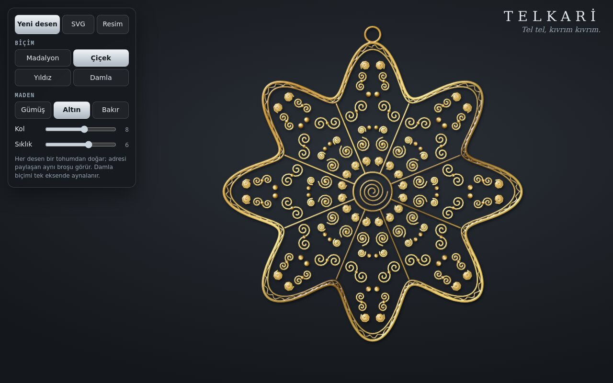

# Telkari

**[Canlı aç](https://py.execore.cloud/projects/telkari/)** · [Galeride önizle](https://py.execore.cloud/#/onizleme/telkari) · [← Tezgâh](../../README.md)

> Gümüş tel işçiliği: kıvrım kıvrım spiraller simetriyle çoğalıp kendiliğinden bir broş, küpe ya da madalyon deseni örer.

## Ne yapar?

Her basışta yeni bir telkari parçası örülür: madalyon, çiçek, yıldız ya da damla biçiminde bir çerçeve, içinde iç içe spiraller, S kıvrımları ve granüller. Teller önce tek tek çizilir, sonra parlatılır. Gümüş, altın ya da bakır seçilebilir; kol sayısı ve sıklık deseni değiştirir. Damla biçimi tek eksende aynalanır ve küpe kancasıyla gelir.

## Nasıl çalışır?

- **Yarım dilim, sonra simetri:** Desenin yalnız yarım dilimi üretilir. Bu dilim bir kez tanımlanır; aynalanmış ve döndürülmüş kopyaları SVG `<use>` ile çizilir. 8 kollu bir broşta 16 kopya aynı tanımı paylaşır.
- **Boşluğa en büyük kıvrım:** Dilimin içinden kutupsal örnekler alınır. Her örnek için sığabilecek en büyük çember hesaplanır (çerçeveye, dilim tellerine, göbeğe ve önceki kıvrımlara uzaklık). 90 örneğin en büyüğü yerleşir; sığan çember çok küçülünce doldurma durur. Büyük çemberler spiral ya da S kıvrımı olur, küçükler granül.
- **Spiral:** Kenardan içe doğru daralan Arşimet benzeri eğri. Tur sayısı ve dönüş yönü tohumdan gelir, böylece aynı adres aynı broşu verir.
- **Maden parlaklığı:** Tellerin saydamlığı bulanıklaştırılıp yükseklik haritası gibi kullanılır. `feSpecularLighting` ile tek yönlü ışık vurur; ışık kopyalarla birlikte dönmediği için bütün parçada parlama aynı yerden gelir. Altta yumuşak bir gölge var.
- **Adres:** Tohum, biçim, maden, kol ve sıklık adreste taşınır (`#k1.m.g.6.5`).

## Kontroller

- **Yeni desen** (ya da `N` / Boşluk), **SVG** ve **Resim** (1600 piksel PNG) indirme.
- **Biçim:** Madalyon, Çiçek, Yıldız, Damla. **Maden:** Gümüş, Altın, Bakır.
- **Kol** (3–12) ve **Sıklık** (1–9).

## Dosyalar

| Dosya | İçerik |
| --- | --- |
| `app.js` | biçim sınırları, çember yerleştirme, spiral ve S kıvrımı, SVG çizimi, parlatma süzgeci, dışa aktarma |

---

Bağımlılık yok: dosyaları bir statik sunucuda aç ya da depo kökünde `npm run dev` çalıştır. Tezgâh'ın bir ilmeği.
