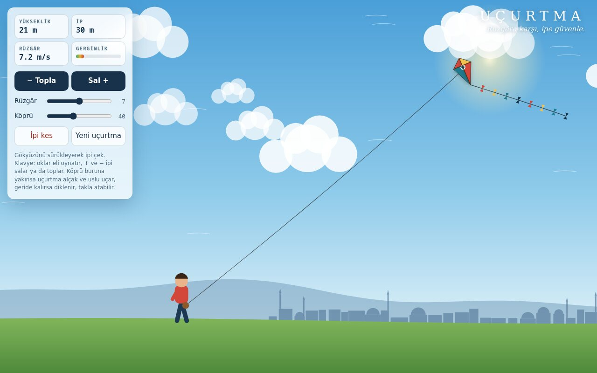

# Uçurtma

**[Canlı aç](https://py.execore.cloud/projects/ucurtma/)** · [Galeride önizle](https://py.execore.cloud/#/onizleme/ucurtma) · [← Tezgâh](../../README.md)

> İpinden tutulan bir uçurtma: rüzgâr eser, kuyruk dalgalanır, ip gerilir ya da boşalır. İpi sal, topla, köprüyü ayarla, istersen kes.

## Ne yapar?

Bir tepede, ipi elinde bir çocuk. Rüzgâr yerden yükseldikçe güçlenir, ara ara sertleşip durulur. Uçurtma kendi dengesini bulur: hafif rüzgârda zorlanıp yere iner, iyi rüzgârda 45–50° açıyla durur. Kuyruk ve fiyonklar savrulur, ip sarkar ya da gerilir. İpi salıp toplayabilir, gökyüzünü sürükleyerek ipi çekebilirsin. **Köprü** ayarı uçurtmanın karakterini değiştirir. İpi kesersen uçurtma rüzgârla uzaklaşır.

## Nasıl çalışır?

- **Verlet parçacıkları:** Uçurtma üç parçacıklı rijit bir üçgen: burun, kuyruk ve ipin bağlandığı köprü noktası. İp 36, kuyruk 16 halkalık zincir. Konumlar Verlet ile, saniyede 240 adımla ilerler. Uzunluklar her adımda 18 kez düzeltilir. İp ve kuyruk halkaları yalnız gerilince çeker, sarkabilir.
- **Hava kuvveti:** Yelken düz bir levha sayılır: `F = k·(w·n)·|w|·n`. Burada `w` göreli rüzgâr, `n` yelkenin normali. Kuvvet basınç merkezine (çıtanın burundan %40'ı) uygulanır, ayrıca küçük bir sürtünme bileşeni var. Uçurtmanın açısı bu kuvvetle köprünün çekişi arasındaki dengeden kendiliğinden çıkar.
- **Köprü:** Bağlantı noktası buruna yaklaşınca hücum açısı küçülür: uçurtma alçak ama uslu uçar. Kuyruğa yaklaşınca diklenir, kaldırma artar ama dengesizleşip takla atabilir. Ayarlar tarayıcıdan önce Node'da benzetimle denendi: varsayılan ayarda 7 m/s rüzgârda ip yaklaşık 47°, 11 m/s'de 52° açıyla durur.
- **Rüzgâr:** Yükseklikle artar (`(h/10)^0.18`), iki ölçekli tohumlu gürültüyle sertleşip durulur, küçük bir dikey bileşeni var. Kuyruk ve ip de göreli rüzgârla sürüklenir.
- **Çizim:** Fizik yandan bakışla çalışır; uçurtma bize dönük bir eşkenar dörtgen olarak çizilir ve çıtanın eğiminin bir kısmı yatışa çevrilir. Kamera uçurtmayı ve çocuğu kadrajda tutacak biçimde yumuşakça yakınlaşıp uzaklaşır.
- **Adres:** Rüzgâr, ip boyu ve köprü ayarı adreste taşınır (`#7.30.40`).

## Kontroller

- **Sal +** ve **− Topla** (basılı tut), klavyede `+` ve `−`.
- **Gökyüzünü sürükle:** eli oynatıp ipi çek; klavyede oklar.
- **Rüzgâr** (0–14 m/s), **Köprü** (32–52).
- **İpi kes**, **Yeni uçurtma**.

## Dosyalar

| Dosya | İçerik |
| --- | --- |
| `physics.js` | Verlet dünyası: uçurtma üçgeni, ip ve kuyruk zincirleri, hava kuvveti, rüzgâr alanı, ip kesme |
| `app.js` | gökyüzü, şehir silueti, çocuk, ip ve uçurtma çizimi; kamera, denetimler |

---

Bağımlılık yok: dosyaları bir statik sunucuda aç ya da depo kökünde `npm run dev` çalıştır. Tezgâh'ın bir ilmeği.
