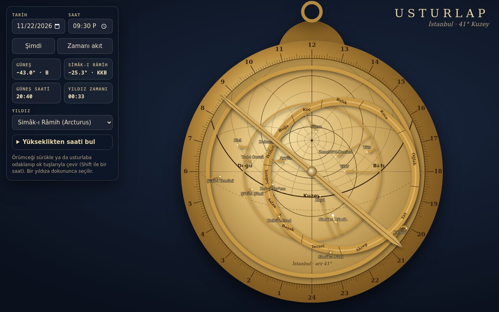

# Usturlap

**[Canlı aç](https://py.execore.cloud/projects/usturlap/)** · [Galeride önizle](https://py.execore.cloud/#/onizleme/usturlap) · [← Tezgâh](../../README.md)

> İstanbul enlemine göre çalışan bir usturlap: örümceği çevir, yıldızların ve Güneş'in yüksekliğini oku; ölçtüğün yükseklikten saati bul.

## Ne yapar?

Pirinç bir usturlap. Levhaya İstanbul'un ufku, yükseklik çemberleri (mukantarat), yön çizgileri ve tan vakti çizgisi kazınmış. Üstündeki örümcekte (rete) on altı parlak yıldızın dili, burçlarıyla tutulum çemberi ve Güneş var. Örümceği parmakla çevirince zaman ilerler ya da geriler. Cetvel Güneş'ten geçer ve bilezikte güneş saatini gösterir. Panel o anki Güneş'in ve seçili yıldızın yüksekliğini ve yönünü, güneş saatini ve yıldız zamanını yazar.

Usturlabın asıl işi de var: bir cismin yüksekliğini ölçüp girersen ("Güneş doğuda 20°") örümcek o ana döner ve saati söyler.

## Nasıl çalışır?

- **Stereografik izdüşüm:** Gök küresi güney kutbundan ekvator düzlemine düşürülür. Dik açıklığı δ olan nokta merkezden `R·tan((90°−δ)/2)` uzaklığa düşer. Çemberler çember kalır: ufuk ve yükseklik çizgileri levhada kaymış çemberler olur.
- **Levha ve örümcek:** Ufuk koordinatındaki her çizgi (yükseklik, yön) ekvator koordinatına çevrilip izdüşürülür; levha bir kez çizilir ve saklanır. Örümcek yıldız zamanı kadar döner: yıldızın saat açısı `H = yıldız zamanı − sağ açıklık`.
- **Zaman:** Yıldız zamanı Greenwich ortalama yıldız zamanından ve İstanbul'un boylamından (28.98° D) hesaplanır. Güneş'in konumu düşük duyarlıklı güneş formülüyle bulunur (yaklaşık 0.01°). Saat TSİ'dir (UTC+3).
- **Yükseklikten saat:** `cos H = (sin a − sin φ sin δ) / (cos φ cos δ)`. Cisim doğudaysa H eksi, batıdaysa artı alınır. Güneş'in dik açıklığı gün içinde az değiştiği için hesap iki adımda yakınsar.
- **Yıldızlar:** J2000 konumları; yalpalama (presesyon) yok sayılır (bugün için yaklaşık 0.4°). Adlar usturlapçıların kullandığı Arapça kökenli adlar: Ayyûk (Capella), Kalbü'l-Akreb (Antares), Vâkı' (Vega)…
- **Adres:** Zaman ve seçili yıldız adreste taşınır.

## Kontroller

- **Örümceği sürükle** ya da usturlaba odaklanıp **oklar** (4 dakika; Shift ile 1 saat).
- **Tarih/Saat**, **Şimdi**, **Zamanı akıt** (saniyede yaklaşık 4 saat).
- **Yıldız** seçimi (ya da yıldızın ucuna dokun).
- **Yükseklikten saati bul:** cisim, ölçülen yükseklik ve doğu/batı yarısı.

## Dosyalar

| Dosya | İçerik |
| --- | --- |
| `app.js` | yıldız ve Güneş hesabı, koordinat dönüşümleri, levha, örümcek ve cetvel çizimi, etkileşim, saat bulma |

---

Bağımlılık yok: dosyaları bir statik sunucuda aç ya da depo kökünde `npm run dev` çalıştır. Tezgâh'ın bir ilmeği.
