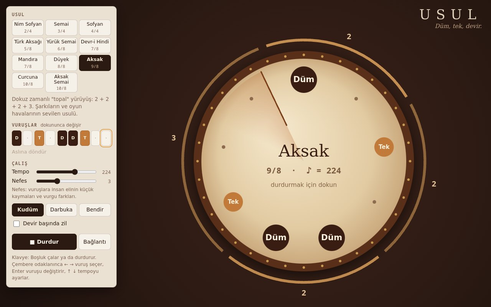

# Usul Makinesi

**[Canlı aç](https://py.execore.cloud/projects/usul-makinesi/)** · [Galeride önizle](https://py.execore.cloud/#/onizleme/usul-makinesi) · [← Tezgâh](../../README.md)

> Düyek, Sofyan, Aksak 9/8, Curcuna 10/8… Türk usullerini düm-tek ile çalan, usulü bir davul derisinin üstünde çemberde döndüren ritim makinesi.

## Ne yapar?

On bir usulden birini seç, **Çal**'a bas: usul davul derisinin üstünde döner, ibre vuruştan vuruşa akar, çalan vuruş parlar. Dış halkadaki yaylar usulün iç gruplarını gösterir (Aksak için 2 + 2 + 2 + 3); aksaklığı hem görür hem duyarsın. Bir vuruşa dokununca düm → tek → ke → sus diye değişir, böylece usulü kendin süsleyebilirsin. Kudüm, darbuka ya da bendir sesiyle, istersen devir başında zille çalar.

## Nasıl çalışır?

- **İleri zamanlayıcı:** 25 ms'de bir uyanan bir döngü, önündeki ~120 ms içindeki vuruşları `AudioContext` saatine yerleştirir. Ritim tarayıcının zamanlayıcı sarsıntısından etkilenmez, tempo çalarken değiştirilebilir.
- **Örneksiz ses:** Düm, perdesi düşen bir sinüs gövde, bir üst kısmi ve kısa bir tokmak tıkırtısıdır. Tek ise bant geçiren gürültüyle kısa bir tonun toplamıdır. Bendirin vızıltısı ayrı bir gürültü bandından gelir. Zil, birbirine uymayan dört kısmi ton ve tiz gürültüden oluşur.
- **Nefes:** Her vuruşa birkaç milisaniyelik kayma ve vurgu farkı ekler; makine, eldeki çalgıya yaklaşır.
- **Ekranla ses aynı anda:** Çizim, ses saatinden okunan son vuruşu ve ondan bu yana geçen kesri kullanır; çıkış gecikmesi düşülür.
- **Adres:** Usul, tempo, kalıp, çalgı, zil ve nefes adreste taşınır (`#aksak.224.D-T-DDT--.k.0.3`). Bağlantıyı açan aynı usulü aynı tempoda çalar.

## Usuller

| Usul | Ölçü | Grup | Düm-tek |
| --- | --- | --- | --- |
| Nim Sofyan | 2/4 | 1 + 1 | Düm Tek |
| Semai | 3/4 | 3 | Düm Tek Tek |
| Sofyan | 4/4 | 4 + 4 (sekizlik) | Düm · · · Te Ke Tek · |
| Türk Aksağı | 5/8 | 2 + 3 | Düm · Tek Tek · |
| Yürük Semai | 6/8 | 3 + 3 | Düm Tek Ke Düm Tek · |
| Devr-i Hindi | 7/8 | 3 + 4 | Düm · Tek Düm · Tek · |
| Mandıra | 7/8 | 2 + 2 + 3 | Düm · Tek · Düm Tek · |
| Düyek | 8/8 | 4 + 4 | Düm Tek · Tek Düm · Tek · |
| Aksak | 9/8 | 2 + 2 + 2 + 3 | Düm · Tek · Düm Düm Tek · · |
| Curcuna | 10/8 | 3 + 2 + 2 + 3 | Düm · Tek Tek · Düm · Tek · · |
| Aksak Semai | 10/8 | 3 + 2 + 2 + 3 | Düm · · Tek · Düm Düm Tek · · |

Bunlar meşkte kullanılan yaygın yazımlardır; icrada usuller hocaya, bölgeye ve esere göre velveleli (süslü) çalınır. Vuruşları değiştirerek kendi velveleni kurabilirsin.

## Kontroller

- **Usul**, **vuruşlar** (dokunarak değiştir, *Aslına döndür* ile geri al)
- **Tempo:** ölçü biriminde (♩ ya da ♪) dakikada 40–320
- **Nefes**, **çalgı** (kudüm, darbuka, bendir), **devir başında zil**
- **Klavye:** Boşluk çalar ya da durdurur. Çembere odaklanınca ← → vuruş seçer, Enter değiştirir, ↑ ↓ tempoyu 4'er (Shift ile 10'ar) ayarlar.
- Çemberin ortasına dokunmak da çalar ya da durdurur.

## Dosyalar

| Dosya | İçerik |
| --- | --- |
| `usuller.js` | usuller, gruplar, açıklamalar, adres kodlaması |
| `ses.js` | davul ve zil sentezi, ileri zamanlayıcı |
| `app.js` | usul çemberi, vuruş düzenleme, panel ve klavye |

---

Bağımlılık yok: dosyaları bir statik sunucuda aç ya da depo kökünde `npm run dev` çalıştır. Tezgâh'ın bir ilmeği.
